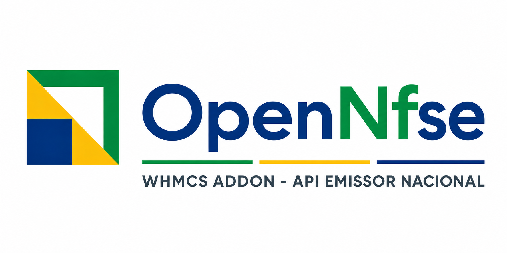
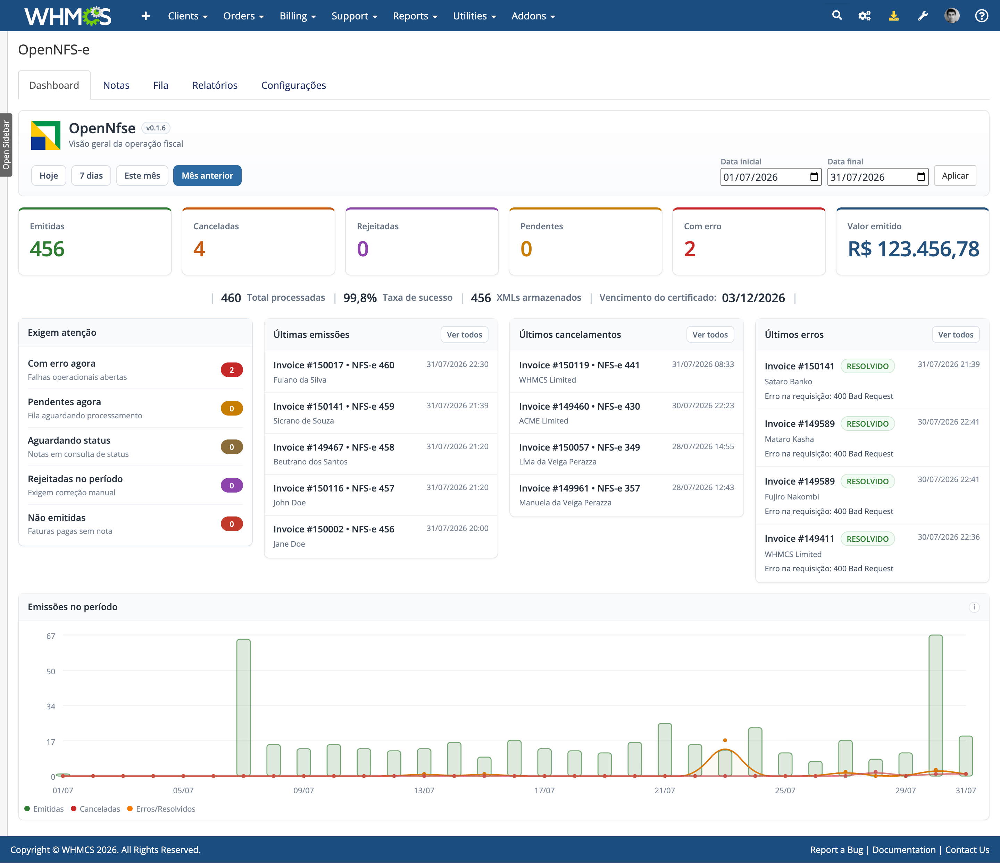

# OpenNfse



Addon para WHMCS com emissão de NFS-e Nacional integrada à API oficial, emissão automática quando a fatura é paga ou gerada, controle de automação por gateway de pagamento, configuração de NBS e código de serviço, geração de DANFS-e em PDF, armazenamento de XML organizado por ambiente e série, consulta de status, fila de processamento, envio de XML/PDF por e-mail ao cliente e atualização do próprio módulo pelo admin do WHMCS.

## Notas do Autor

**Atualizado em 6 de novembro de 2026.**

O addon está em uso em produção há mais de dois meses. Nesse período, o uso real revelou diversos problemas inesperados, que foram corrigidos versão a versão.

A versão 1.0.0 traz duas mudanças grandes: o visual novo do admin (Dashboard, Fila, Relatórios e Configurações) e o **atualizador embutido**.

Nos próximos meses ainda haverá várias atualizações: ajustes da NT 009, que entra em produção em 01/12/2026, correções e funções novas. Até aqui, cada atualização era feita à mão: baixar o zip, apagar a pasta, enviar a nova e torcer para nada dar errado. Em um módulo fiscal, um erro nesse processo para a emissão de notas, e esse atrito fazia muita gente adiar a atualização. O atualizador existe para tirar esse atrito: a partir da 1.0.0, a atualização é feita pela tela **Configurações > Atualizações**, em etapas, com backup e volta ao estado anterior se algo der errado. Veja [Atualizador embutido](#atualizador-embutido).

A instalação da 1.0.0 ainda é manual, uma única vez. As versões seguintes já podem ser instaladas pelo atualizador.

Ao começar a usar o addon, configure primeiro o ambiente de homologação. Se estiver testando em uma instalação de produção do WHMCS, não ative as automações de emissão. Valide as notas emitidas no ambiente de homologação do Emissor Nacional com a sua contabilidade e confira se todos os campos foram preenchidos corretamente.

O leiaute da DPS segue a NT 009 e muda automaticamente em produção em 01/12/2026 (configurável em **Leiaute da DPS**). Depois de atualizar, clique em **Testar conexão** e, se houver erro de certificado, atualize o pacote `ca-certificates` do servidor.

Se encontrar algum problema ou tiver uma sugestão, [abra uma issue](https://github.com/jaison/OpenNfse/issues/new).

## Screenshot



## Visão Geral

- Compatível com WHMCS `8.13.x` ou `9.1`. A v1.0.0 foi validada no WHMCS `9.1`.
- Requer PHP `8.1+`.
- Usa a SDK `nfse-nacional/nfse-php`.
- Usa `vendor-scoped` para reduzir o risco de conflito com dependências de outros módulos do WHMCS.
- Emite automaticamente no pagamento ou na geração da fatura, com controle por gateway, por grupo de clientes e por custom field.
- Permite configurar código de serviço, NBS, alíquota e parâmetros tributários padrão.
- Suporta emissão de NFS-e para clientes no Brasil e no exterior.
- Gera DANFS-e em PDF e envia XML/PDF por e-mail ao cliente, inclusive de forma automática após a emissão.
- Possui fila de processamento, cron integrado ao WHMCS e consulta automática e manual de status.
- Organiza os XMLs emitidos por ambiente, série, ano e mês.
- Atualiza o próprio módulo pelo admin, com pausa da operação, backup das tabelas e volta ao estado anterior.

## Panorama Funcional

### Automação Fiscal
- Emissão automática de NFS-e quando a fatura é paga ou quando é gerada.
- Controle de automação por gateway de pagamento, por grupo de clientes e por custom field do cliente.
- Fila de processamento para emissões, reprocessamentos e consultas de status.
- Enfileiramento manual de faturas com status `Unpaid`, quando a opção de emissão manual de faturas não pagas estiver habilitada.
- Envio automático configurável de PDF e XML por e-mail, uma vez por nota, quando ela é emitida (com ou sem fila), com novas tentativas automáticas em caso de falha.
- Reconciliação automática de emissões quando a API nacional retorna indisponibilidade transitória, como erro `503`, timeout ou falha de conexão.
- Alertas quando uma fatura com NFS-e é alterada, cancelada, reembolsada ou volta a ficar em aberto.
- Cron integrado ao WHMCS com proteção contra execução duplicada.

### Operação de Notas
- Emissão manual, reemissão e cancelamento de NFS-e pelo admin.
- Consulta manual e automática de status da nota.
- Emissão de NFS-e para tomadores nacionais e estrangeiros.
- Download individual de XML e PDF.
- Envio de XML e PDF por e-mail.

### Dashboard e Monitoramento
- Dashboard operacional do período, com navegação por mês, Hoje, 7 dias e período personalizado.
- Barra de saúde: "Operação em dia" ou o que exige atenção (erros, pendentes, rejeitadas, aguardando status, faturas pagas sem nota, certificado perto do vencimento, não configurado ou ilegível, alertas abertos, cron parado), cada contador com link para a tela certa.
- Fila agora, ao lado dos indicadores: itens pendentes, em processamento, aguardando status e com erro neste momento, a última execução do cron, o pendente mais antigo e o botão para processar a fila.
- Indicadores de emitidas, valor emitido, canceladas, taxa de sucesso, processadas e XMLs armazenados.
- Calendário de calor das emissões por dia, média por dia da semana e linha do tempo de emitidas, canceladas e erros na mesma escala.
- Atividade recente numa lista só, com filtros por tipo e por dia.
- Barra de navegação em todas as telas do addon, com o título da tela, o estado da fila e o aviso de versão nova.

### Relatórios e Exportações
- Relatórios agrupados em Notas (emitidas, cancelamentos, histórico fiscal), Conferência (auditoria de emissão, NFS-e de faturas não pagas, auditoria DPS > API, auditoria de XML) e Diagnóstico (falhas e logs).
- Auditoria de emissão para identificar faturas pagas sem NFS-e e sem item correspondente na fila.
- Auditoria de XML para localizar órfãos, referências quebradas e inconsistências de armazenamento.
- Histórico fiscal da fatura com emissões, cancelamentos e snapshots operacionais.
- Auditoria DPS > API para conferência direta com a API nacional e detecção de lacunas na sequência.
- Logs técnicos com visualização detalhada de request/response.
- Exportação CSV de NFS-e emitidas, falhas, cancelamentos, auditoria de emissão e logs.
- Download em ZIP dos XMLs emitidos no período e atalhos para baixar os XMLs por competência.

### Área do Cliente
- Listagem das NFS-e emitidas vinculadas ao cliente.
- Resumo da NFS-e emitida na tela da fatura do cliente, com número, data de emissão, chave e ações rápidas. Sem nota emitida, a fatura não mostra nada da NFS-e.
- Download de XML e PDF pelo cliente.
- Reenvio de XML/PDF por e-mail pelo cliente.
- Aviso configurável na área do cliente.

### Configuração e Cadastros
- Configurações organizadas em grupos (Empresa, Fiscal, Integração, Documentos e Sistema), com explicações curtas em cada campo e detalhes em **Como funciona**.
- Ambiente, certificado digital e dados do prestador.
- Série DPS, sequenciais e parâmetros de processamento.
- Envio automático de PDF e XML por e-mail.
- Emissão manual de faturas com status `Unpaid`, permitindo ou bloqueando o enfileiramento dessas faturas.
- Catálogo de código de serviço e NBS, com mapeamento por grupo de produto do WHMCS.
- Habilitação da automação por gateway de pagamento.
- DANFS-e e personalização do cabeçalho do PDF.
- Dados padrão do tomador e sincronização de municípios IBGE, com fallback via ViaCEP.
- Política de retenção de logs e fila.
- Aba **Atualizações**: versão instalada, versão mais recente, notas da versão, requisitos e o botão **Atualizar agora**.

## Atualizador Embutido

### Por que existe

Atualizar um módulo fiscal à mão é arriscado: uma pasta enviada pela metade, um arquivo de outra versão esquecido ou uma dependência faltando param a emissão de notas, e muitas vezes só se percebe quando o cliente reclama. Esse risco fazia as atualizações serem adiadas, e instalações desatualizadas perdem correções importantes, como as da NT 009.

O atualizador faz o mesmo trabalho em etapas, com conferências antes e depois, e deixa sempre um caminho de volta.

### Como funciona

Em **Addons > OpenNfse > Configurações > Atualizações**, quando há versão nova, o botão **Atualizar agora** abre a tela de atualização, com quatro etapas:

1. **Checagem.** Confere, sem alterar nada, se o servidor permite atualizar:
   - se a versão nova tem pacote publicado com SHA-256;
   - as versões mínimas de PHP e WHMCS;
   - as extensões do PHP;
   - se a instalação foi feita com o pacote do release;
   - se a pasta temporária do WHMCS está configurada e gravável;
   - se o PHP consegue criar, renomear e apagar pastas em `modules/addons`;
   - o espaço em disco.

   Os testes de escrita criam e apagam arquivos de verdade. Se algum item bloquear, a tela explica o que falta.
2. **Pausa da operação.** Para tudo o que é do OpenNfse até o fim da atualização: emissão, fila, cron, alertas, e-mails automáticos, área do cliente e downloads de NFS-e.
   - Os eventos de fatura que chegarem nesse período, como pagamentos e cancelamentos, ficam guardados e são processados na volta, na ordem em que chegaram.
   - A tela espera terminar o que estiver em andamento antes de liberar a próxima etapa.
   - Até a troca dos arquivos, **Retomar operação** cancela a atualização.
3. **Backup das tabelas.** Gera um arquivo com a estrutura e os dados de todas as tabelas `mod_opennfse_*`, e o download é obrigatório.
   - O arquivo traz a configuração do módulo. Guarde-o em local seguro.
   - Se a pasta temporária do WHMCS ficar fora do webroot, uma cópia fica no servidor até a confirmação, e a volta usa essa cópia.
4. **Atualização.**
   - Baixa o pacote do release no GitHub e confere o SHA-256.
   - Extrai e confere a estrutura, a versão e a sintaxe do código.
   - Troca a pasta do módulo pela nova. A anterior fica guardada como `OpenNfse.old`.
   - Em seguida, já com o código novo, roda as migrations e faz uma checagem final.

Depois da troca há duas saídas:

- **Confirmar e retomar operação**: apaga a versão anterior e a cópia do backup e retoma a operação.
- **Voltar ao estado anterior**: restaura as tabelas pelo backup e devolve a pasta anterior ao lugar. A operação continua pausada até você retomar.

### Se o WHMCS não abrir depois da troca

A tela mostra estas instruções antes da instalação. Pelo FTP ou pelo gerenciador de arquivos, em `modules/addons/`:

1. Renomeie a pasta `OpenNfse` para `OpenNfse.falhou`.
2. Renomeie a pasta `OpenNfse.old` para `OpenNfse`.

Depois, importe no banco o arquivo de backup baixado na etapa 3 (por exemplo, pelo phpMyAdmin). Com a versão anterior de volta, a tela de atualização libera o botão **Retomar operação**.

### Quando a atualização automática não está disponível

- **Instalação manual ou checkout git.** O atualizador só funciona em instalações feitas com o arquivo `OpenNfse-<versão>.zip` do release, que traz o marcador `build-info.json`. Instalações a partir do código-fonte ou de um checkout git devem continuar sendo atualizadas do mesmo jeito que foram instaladas.
- **Versões anteriores à 1.0.0.** Elas não têm o atualizador. A passagem para a 1.0.0 é manual, uma vez (ver [Atualização manual](#atualização-manual)).
- **Servidor sem permissão.** Se o PHP não puder gravar em `modules/addons` ou na pasta do módulo, a checagem bloqueia e a atualização continua possível à mão.

### Canal de testes

Na aba **Atualizações**, o **Canal de atualização** pode ser **Estável** (padrão) ou **Testes**. O canal de testes também oferece as pré-releases publicadas no GitHub. Use-o só em ambiente de homologação.

## SDKs e Bibliotecas de Terceiros

Este projeto usa bibliotecas de terceiros para a integração com a NFS-e Nacional, a geração de PDF e o empacotamento seguro das dependências:

- [`nfse-nacional/nfse-php`](https://github.com/nfse-nacional/nfse-php):
  SDK principal de integração com a API Nacional da NFS-e.
- [`paseto/nfse-nacional-pdf`](https://github.com/paseto/nfse-nacional-pdf):
  biblioteca base para geração do DANFS-e em PDF.
- [`humbug/php-scoper`](https://github.com/humbug/php-scoper):
  usada no build para gerar a pasta `vendor-scoped/` e reduzir conflitos de dependências com outros módulos do WHMCS.
- [`phpunit/phpunit`](https://github.com/sebastianbergmann/phpunit):
  testes automatizados no ambiente de desenvolvimento.
- [`squizlabs/php_codesniffer`](https://github.com/PHPCSStandards/PHP_CodeSniffer):
  verificação de padrão de código no desenvolvimento.

## Fontes de Dados Externas

Além das bibliotecas, o módulo usa fontes externas para enriquecer e validar dados de municípios:

- [`kelvins/municipios-brasileiros`](https://github.com/kelvins/municipios-brasileiros):
  fonte primária do catálogo de municípios e códigos IBGE usado para popular a base local do módulo.
- [`ViaCEP`](https://viacep.com.br/):
  fallback para a resolução de município e UF a partir do CEP, quando necessário.

## Estrutura do Repositório

- `src/`:
  código-fonte principal do módulo. O atualizador fica em `src/Updater/`.
- `assets/`:
  CSS e recursos visuais do admin e da área do cliente.
- `templates/`:
  templates da área do cliente.
- `migrations/`:
  migrations de banco do addon.
- `docs/`:
  documentação técnica e operacional, com índice em [`docs/README.md`](docs/README.md).
- `vendor-scoped/`:
  dependências prontas para uso no ambiente final.
- `.github/workflows/`:
  workflow que gera o pacote de instalação de cada release.
- `tests/`, `tools/`:
  testes e ferramentas de build. Não entram no pacote de instalação.

## Requisitos

- PHP `^8.1`
- WHMCS `8.13.x` ou `9.1` (a v1.0.0 foi validada no `9.1`)
- MySQL `5.7.5+` ou MariaDB `10.0.2+` (recomendado; em versões anteriores o módulo funciona, com a fila protegida só pelo lock do cron, como explicado em [docs/INSTALACAO.md](docs/INSTALACAO.md))
- Extensões PHP: `openssl`, `curl`, `dom`, `simplexml`, `mbstring`, `zlib` e `zip`
- Pacote de certificados raiz (`ca-certificates`) atualizado no servidor
- Certificado A1 válido (`.pfx` ou `.p12`), fora do webroot
- Para o atualizador embutido:
  - **Temporary Path** configurado em **Utilities > Update WHMCS** (a mesma pasta que o WHMCS usa nas próprias atualizações) e gravável pelo PHP;
  - o PHP precisa poder gravar em `modules/addons/` e na pasta do módulo.

## Instalação

1. Na [página de releases](https://github.com/jaison/OpenNfse/releases), baixe o arquivo **`OpenNfse-<versão>.zip`** da versão desejada, que fica na lista de arquivos do release. Não use os arquivos "Source code": eles criam uma pasta com outro nome e não trazem o marcador que o atualizador exige.
2. Extraia o arquivo. Ele cria a pasta `OpenNfse`.
3. Copie a pasta `OpenNfse` para `modules/addons/` do WHMCS. Confira se os arquivos ocultos `.htaccess` (na raiz e em `assets/`) foram copiados.
4. No admin do WHMCS, acesse `Configuration > System Settings > Addon Modules`.
5. Ative o addon `OpenNfse`.
6. Após a primeira ativação, clique em `Configure` e, em `Access Control`, marque quais grupos de usuários do WHMCS terão acesso ao addon.
7. Acesse `Addons > OpenNfse` e preencha a configuração inicial.

## Atualização

A partir da 1.0.0, use o [atualizador embutido](#atualizador-embutido): **Addons > OpenNfse > Configurações > Atualizações > Atualizar agora**.

O módulo consulta o GitHub pelo cron, no máximo uma vez por dia, e avisa na barra do addon quando há versão nova. O botão **Verificar agora** consulta na hora.

### Atualização manual

Use este caminho para sair de uma versão anterior à 1.0.0, ou quando o atualizador não estiver disponível no seu servidor:

1. Baixe o arquivo `OpenNfse-<versão>.zip` do release e extraia.
2. Apague a pasta `modules/addons/OpenNfse/` da versão anterior e envie a pasta `OpenNfse` nova para `modules/addons/`.
   - O módulo não guarda dados nessa pasta: a configuração fica no banco, os XML e PDF ficam em `attachments/` e o certificado A1 fica obrigatoriamente fora do webroot (`public_html`), conforme [docs/SEGURANCA.md](docs/SEGURANCA.md).
   - Enviar por cima também funciona, mas deixa no servidor arquivos que a versão nova não usa mais.
3. As migrations novas rodam sozinhas no próximo acesso ao addon. No admin do WHMCS, acesse `Addons > OpenNfse`, revise a configuração e clique em **Testar conexão**.

## Configuração Inicial

- Configure ambiente, certificado digital e dados do prestador.
- Em **Leiaute da DPS**, mantenha **Automático**. Ele segue a NT 009: em homologação o leiaute novo já vale; em produção ele passa a valer em 01/12/2026 00:00 (horário de Brasília). A tela mostra o leiaute ativo. Só force **Pré-NT 009** ou **NT 009** se a SEFIN rejeitar a DPS com E1235 por leiaute; nesse caso a mensagem de erro da nota indica o ajuste.
- Configure a série DPS conforme a operação desejada.
- Revise as opções de fila e processamento automático.
- Em **Automação de E-mail**, configure **Enviar PDF/XML automaticamente por e-mail?** como `Sim` para enviar os anexos quando a nota for emitida; a opção vem desativada por padrão. Cada nota recebe um e-mail automático; uma reemissão gera nota nova e, portanto, um e-mail novo.
- Se usar a emissão automática **Quando a fatura for gerada**, não repasse taxas ao cliente nos gateways marcados em **Emitir ao gerar a fatura**:
  - a NFS-e usa o valor da fatura na geração;
  - taxa, juros, multa ou desconto acrescentados no pagamento deixam o valor da fatura diferente da nota e abrem o alerta "Fatura alterada com NFS-e" (o PagHiper, por exemplo, inclui a taxa só depois do pagamento);
  - como não dá para saber de antemão qual gateway o cliente vai usar, e cada um pode ter uma taxa diferente, o recomendado é não repassar taxas nesses gateways.
- Emita manualmente faturas com status `Unpaid` somente quando a opção **Permitir enfileirar manualmente a emissão de faturas não pagas?** estiver configurada como `Sim`.
- Salve a configuração antes de realizar testes de emissão.

## Armazenamento de Arquivos

- XMLs de emissão e cancelamento são gravados em:

```text
attachments/nfse/xml/{ambiente}/{serie}/{ano}/{mes}/
```

- Exemplos da estrutura física no servidor:

```text
attachments/nfse/xml/homologacao/900/2026/06/
attachments/nfse/xml/producao/1/2026/06/
```

- Nessa estrutura, os XMLs ficam agrupados por ambiente, série e mês de referência do documento salvo.
- Os nomes dos arquivos seguem o padrão:

```text
nfse_{numero}_{invoiceid}_{mmyyyy}.xml
cancelamento_nfse_{numero}_{invoiceid}_{yyyymmdd_hhmmss}.xml
```

## Baixar XMLs por Competência

- No relatório de notas emitidas, o módulo oferece atalhos para baixar em ZIP os XMLs dos últimos meses fechados.
- O recurso é útil na conciliação com a contabilidade, porque separa os documentos por tipo dentro do arquivo compactado.
- No layout por competência, o ZIP é organizado nas seguintes pastas:

```text
Emitidas/
Canceladas/
Emitidas para Estrangeiros/
```

- A classificação dentro do ZIP segue estas regras:
  - Cada NFS-e (chave de acesso) emitida no período entra uma vez, a partir do histórico fiscal. Assim, uma nota cancelada e depois substituída por reemissão na mesma fatura continua no ZIP.
  - `Emitidas/`: XML das NFS-e emitidas para clientes no Brasil.
  - `Canceladas/`: XML da nota e XML do cancelamento de cada NFS-e cancelada.
  - `Emitidas para Estrangeiros/`: XML das NFS-e emitidas para tomadores com país diferente de `BR`.
- O nome do arquivo gerado segue o padrão `nfse_xml_{mmyyyy}.zip`, facilitando o envio mensal para a contabilidade.

## Cron

- O addon é integrado ao cron do próprio WHMCS.
- Quando o cron principal do WHMCS roda a cada minuto, o processamento automático do módulo é disparado junto.
- O processamento respeita a configuração interna do addon e tem proteção contra execução duplicada no mesmo minuto.
- A automação de emissão depende da fila ligada (**Habilitar fila/cron?** = `Sim`): processamento da fila, consultas automáticas de status e emissão automática (na geração ou no pagamento). Com a fila desligada, o cron faz as novas tentativas do e-mail automático, a conferência diferida dos alertas, a limpeza e a checagem de atualização, e a emissão manual passa a ser feita na hora. Esse comportamento é intencional.
- O envio automático de e-mail vale com ou sem fila: sai quando a nota é emitida e, em caso de falha, o cron faz até 3 novas tentativas (15 minutos, 1 hora e 6 horas depois).
- Em falhas transitórias da API nacional, o cron mantém a nota em processamento e tenta reconciliar a emissão automaticamente nos ciclos seguintes.
- Durante uma atualização (pausa da operação), o cron do módulo não roda. Na volta, ele processa primeiro os eventos de fatura guardados na pausa.
- O arquivo `cron.php` do módulo permanece disponível para compatibilidade, mas a recomendação é usar o cron principal do WHMCS.

## Atualização de Dependências

Se você estiver trabalhando a partir do código-fonte e precisar reconstruir as dependências escopadas:

```bash
composer install
composer run scope
```

Isso reconstrói a pasta `vendor-scoped/`. O `composer install` precisa incluir as dependências de desenvolvimento (sem `--no-dev`), porque o `php-scoper` é dependência de desenvolvimento.

O `vendor-scoped/` leva só as dependências de produção:

- O `scoper.inc.php` parte dos pacotes do `vendor/composer/installed.json` que não estão em `dev-package-names`. O `tools/build-scoped-vendor.php` interrompe o build se o resultado tiver algum pacote a mais ou a menos.
- Da SDK saem `references/`, `examples/`, `scripts/`, `types/`, `tests/` e os scripts e configurações de desenvolvimento da raiz do pacote. Do `paseto/nfse-nacional-pdf` sai o script de exemplo `generate-pdf.php`. De todos os pacotes saem os arquivos `.md` e `.dist` e as pastas `bin/`, `docs/` e de testes.
- Depois de gerar o `vendor-scoped/autoload.php`, o build remove os `composer.json` e `composer.lock` de dentro dos pacotes, que não são usados em runtime e que o Dependabot leria como manifests.
- Uma biblioteca usada em runtime precisa estar no `require` do `composer.json`. O que chega apenas como dependência de desenvolvimento fica fora do `vendor-scoped/`. Por esse motivo, o `symfony/polyfill-intl-normalizer` está no `require`: ele fornece a classe `\Normalizer`, que a SDK usa para normalizar textos quando o servidor não tem a extensão `intl`.

### Versão da SDK nfse-php

O módulo usa a release oficial `v1.24.0-beta` da SDK, fixada no `composer.json` (`"nfse-nacional/nfse-php": "1.24.0-beta"`), sem patches locais. Essa versão já traz as correções que antes eram aplicadas por patch: `vServMoeda` com duas casas, verificação TLS de cadeia e nome (com o IP de Catanduva fixado via `CURLOPT_RESOLVE`), connect timeout de 10s e a ordem de `xDescServ` e `finNFSe` do leiaute da NT 009.

Para trocar de versão, altere o `composer.json`, rode `composer update nfse-nacional/nfse-php`, `composer test` e `composer run scope`, e confira se o diff de `vendor-scoped/` só traz o que mudou na SDK.

## Desenvolvimento Local

- Instalar dependências:

```bash
composer install
```

- Rodar testes:

```bash
composer test
```

- Verificar padrão de código:

```bash
composer cs:check
```

- Aplicar correções automáticas:

```bash
composer cs:fix
```

## Publicar uma Versão

O pacote de instalação é gerado pelo GitHub Actions, então qualquer pessoa com acesso de escrita ao repositório consegue publicar uma versão:

1. Atualize `'version'` em `OpenNfse.php`, rode `composer test` e faça o commit na `main`.
2. Publique o release com a tag `v<versão>` (por exemplo, `v1.0.1`). O workflow **Pacote do release** confere se a versão de `OpenNfse.php` bate com a tag, gera `OpenNfse-<versão>.zip` (com o marcador `build-info.json` e sem testes e ferramentas) e anexa o zip e o `.sha256` ao release.
3. Atualize o `update.json` na `main`:
   - `latest_version`;
   - `package_url` (`https://github.com/jaison/OpenNfse/releases/download/v<versão>/OpenNfse-<versão>.zip`);
   - `package_sha256` (o valor do arquivo `.sha256`);
   - `message`, `minimum_php` e `minimum_whmcs`.

   É esse arquivo que avisa as instalações: sem `package_url` e `package_sha256`, a versão aparece, mas só pode ser instalada à mão.

Uma pré-release publicada com `--prerelease` aparece só para quem usa o canal de testes e não precisa do passo 3.

## Segurança

- O certificado A1 deve ficar fora do webroot do WHMCS.
- O addon traz `.htaccess` que bloqueiam o acesso web direto aos seus arquivos, liberando só CSS e imagens de `assets/`. Em nginx, IIS ou OpenLiteSpeed é preciso configuração extra; veja [docs/SEGURANCA.md](docs/SEGURANCA.md#5-acesso-web-direto-ao-diretório-do-addon).
- O diretório `attachments/` deve ser gravável pelo PHP.
- Certificados `.pfx` com criptografia antiga podem apresentar falhas de leitura ou compatibilidade no servidor.
- Não publique logs, XMLs, PDFs gerados, backups do atualizador ou credenciais.
- As chamadas à SEFIN, ao ADN e ao CNC verificam o certificado TLS do servidor. Se o teste de conexão falhar com erro de certificado (por exemplo `unable to get local issuer certificate`), atualize o pacote de CAs do servidor (`ca-certificates`) ou aponte `curl.cainfo` no `php.ini` para um bundle atualizado. A cadeia da SEFIN termina na raiz pública GlobalSign Root R46.
- O atualizador:
  - só baixa pacotes do GitHub, por HTTPS, e só instala o pacote cujo SHA-256 confere com o publicado;
  - só é acessível no admin, para quem tem acesso ao addon;
  - as etapas que alteram arquivos ou dados exigem o token de segurança do formulário, e a checagem final só roda logo depois da troca das pastas.

### Certificado PFX Moderno

Se o certificado A1 estiver em um `.pfx` antigo, ele pode apresentar incompatibilidades no ambiente do servidor. Nesses casos, a recomendação é reexportar o certificado em um PFX moderno.

Se você tiver o certificado original ou acesso ao Windows onde ele foi emitido:

1. Abra `certmgr.msc`.
2. Localize o certificado desejado.
3. Exporte novamente o certificado.
4. Use criptografia `AES`, quando essa opção estiver disponível no assistente.
5. Gere um novo arquivo `.pfx`.

Depois disso, atualize o caminho e a senha do certificado na configuração do módulo e valide novamente o certificado no admin do WHMCS.

## Licença e Uso

Este projeto é disponibilizado para uso pessoal e uso interno por empresas, incluindo estudo, instalação e adaptação para uso próprio.

Sem autorização prévia e expressa do autor, não é permitido:

- vender este software
- revender este software
- sublicenciar este software
- redistribuir este software como produto comercial
- oferecer este software como serviço hospedado/SaaS
- comercializar versões modificadas deste software
- utilizar este software como base para produto concorrente com exploração comercial direta

Se você deseja uso comercial, revenda, sublicenciamento, distribuição paga ou incorporação em oferta comercial, obtenha autorização específica do autor.

Este projeto utiliza como base a Elastic License 2.0 (ELv2), acrescida de cláusulas específicas de não revenda. O texto formal e juridicamente válido está no arquivo [`LICENSE`](LICENSE).
