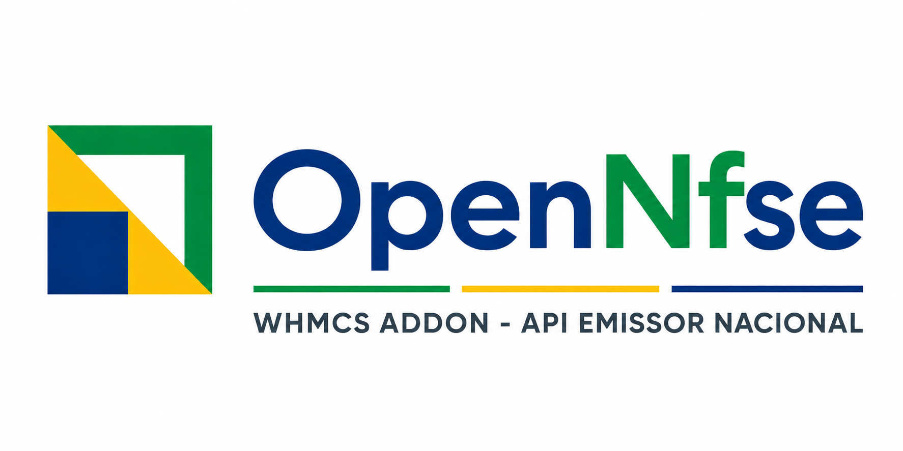
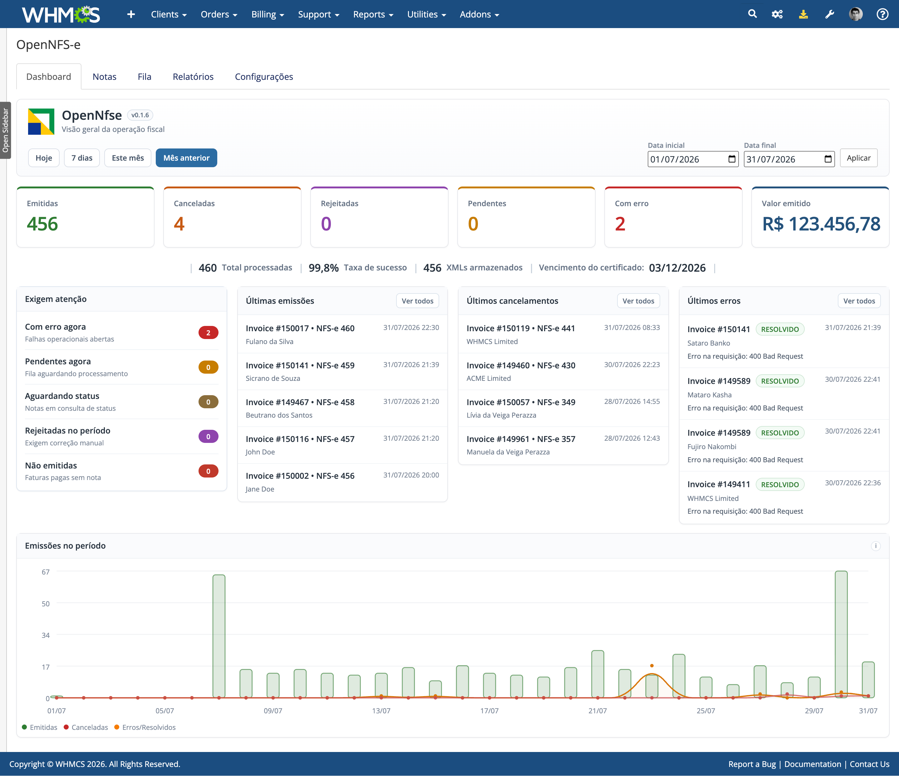

# OpenNfse



Addon para WHMCS com emissão de NFS-e Nacional integrada à API oficial, emissão automática quando a fatura é paga, controle de automação por gateway de pagamento, configuração de NBS e código de serviço, geração de DANFS-e em PDF, armazenamento de XML organizado por ambiente e série, consulta de status, fila de processamento e envio de XML/PDF por e-mail ao cliente.

## Notas do Autor

**Atualizado em 28 de outubro de 2026.**

O addon tem sido testado em produção nos últimos dois meses. Durante o uso real, diversos problemas inesperados foram identificados e resolvidos.

Algumas funções de auditoria existentes já não são mais necessárias e provavelmente serão removidas ou unificadas em uma única tela. Nas próximas atualizações, serão realizados ajustes visuais e adicionadas novas funcionalidades. Mantenha sua instalação atualizada.

Ao começar a utilizar o addon, configure primeiro o ambiente de homologação. Caso esteja testando em uma instalação de produção do WHMCS, não ative as automações de emissão automática. Valide as notas emitidas no ambiente de homologação do Emissor Nacional junto à sua contabilidade e verifique se todos os campos foram preenchidos corretamente.

A partir desta versão, o leiaute da DPS segue a NT 009 e muda automaticamente em produção em 01/12/2026 (configurável em **Leiaute da DPS**); depois de atualizar, clique em **Testar conexão** e, se houver erro de certificado, atualize o pacote `ca-certificates` do servidor.

Caso encontre algum problema ou tenha alguma sugestão, [abra uma issue](https://github.com/jaison/OpenNfse/issues/new).

## Screenshot



## Visão Geral

- Compatível com WHMCS `8.13.x`.
- Requer PHP `8.1+`.
- Usa a SDK `nfse-nacional/nfse-php`.
- Usa `vendor-scoped` para reduzir risco de conflito com dependências de outros módulos do WHMCS.
- Permite emissão automática ao pagamento da fatura, com controle separado por gateway.
- Permite configurar código de serviço, NBS, alíquota e parâmetros tributários padrão.
- Suporta emissão de NFS-e para clientes no Brasil e no exterior.
- Gera DANFS-e em PDF e envia XML/PDF por e-mail ao cliente.
- Permite configurar o envio automático do PDF e XML por e-mail após a confirmação da emissão da NFS-e.
- Possui fila de processamento, cron integrado ao WHMCS e consulta automática/manual de status.
- Permite enfileirar manualmente faturas com status `Unpaid`, conforme a configuração de emissão manual.
- Organiza XMLs emitidos por ambiente, série, ano e mês.

## Panorama Funcional

### Automação Fiscal
- Emissão automática de NFS-e quando a fatura é paga.
- Controle de automação separado por gateway de pagamento.
- Fila de processamento para emissões, reprocessamentos e consultas de status.
- Permite enfileirar manualmente faturas com status `Unpaid` quando a opção de emissão manual de faturas não pagas estiver habilitada.
- Envio automático configurável de PDF e XML por e-mail, uma vez por nota, quando ela é emitida (com ou sem fila), com novas tentativas automáticas em caso de falha.
- Reconciliação automática de emissões quando a API nacional retorna indisponibilidade transitória, como erro `503`, timeout ou falha de conexão.
- Cron integrado ao WHMCS com proteção contra execução duplicada.

### Operação de Notas
- Emissão manual, reemissão e cancelamento de NFS-e pelo admin.
- Consulta manual e automática de status da nota.
- Emissão de NFS-e para tomadores nacionais e estrangeiros.
- Download individual de XML e PDF.
- Envio de XML e PDF por e-mail.

### Dashboard e Monitoramento
- Dashboard operacional com métricas do período.
- Indicadores de emitidas, canceladas, rejeitadas, pendentes, erros e valor emitido.
- Listas rápidas de últimas emissões, últimos erros e últimos cancelamentos.
- Banner administrativo para checagem e aviso de atualização disponível do módulo.
- Atalhos para ações operacionais do dia a dia.

### Relatórios e Exportações
- Relatórios de NFS-e emitidas.
- Relatórios de falhas e rejeições.
- Relatórios de cancelamentos.
- Auditoria de emissão para identificar faturas pagas sem NFS-e e sem item correspondente na fila.
- Auditoria de XML para localizar órfãos, referências quebradas e inconsistências de armazenamento.
- Histórico fiscal da invoice com emissões, cancelamentos e snapshots operacionais.
- Auditoria DPS > API para conferência direta com a API nacional e detecção de lacunas na sequência.
- Relatórios técnicos de logs com visualização detalhada de request/response.
- Exportação CSV de NFS-e Emitidas, Falhas, Cancelamentos, Auditoria Emissão e Logs.
- Download em ZIP dos XMLs emitidos no período.
- Atalhos para baixar XMLs por competência, com organização pensada para conciliação com a contabilidade.

### Área do Cliente
- Listagem das NFS-e emitidas vinculadas ao cliente.
- Resumo da NFS-e diretamente na tela da fatura do cliente, com status, número, chave e ações rápidas.
- Download de XML e PDF pelo cliente.
- Reenvio de XML/PDF por e-mail pelo cliente.
- Aviso configurável na área do cliente.

### Configuração e Cadastros
- Configuração de ambiente, certificado digital e dados do prestador.
- Configuração de série DPS, sequenciais e parâmetros de processamento.
- Configuração do envio automático de PDF e XML por e-mail na seção de processamento automático.
- Configuração da emissão manual de faturas com status `Unpaid`, permitindo ou bloqueando o enfileiramento dessas faturas.
- Catálogo de código de serviço e NBS.
- Mapeamento de código de serviço e NBS por grupo de produto do WHMCS.
- Habilitação da automação por gateway de pagamento.
- Configuração do DANFS-e e personalização de cabeçalho do PDF.
- Dados padrão do tomador e sincronização de municípios IBGE.
- Resolução de municípios com catálogo local alimentado por fonte IBGE e fallback via ViaCEP.
- Política de retenção de logs e fila.
- Checagem manual e automática de atualizações do módulo a partir de manifesto remoto.

## SDKs E Bibliotecas De Terceiros

Este projeto utiliza bibliotecas de terceiros para integração com a NFS-e Nacional, geração de PDF e empacotamento seguro das dependências:

- [`nfse-nacional/nfse-php`](https://github.com/nfse-nacional/nfse-php):
  SDK principal de integração com a API Nacional da NFS-e.
- [`paseto/nfse-nacional-pdf`](https://github.com/paseto/nfse-nacional-pdf):
  biblioteca base para geração do DANFS-e em PDF.
- [`cweagans/composer-patches`](https://github.com/cweagans/composer-patches):
  plugin de build que aplica os patches de `patches/` na SDK antes de gerar o `vendor-scoped/`.
- [`humbug/php-scoper`](https://github.com/humbug/php-scoper):
  utilizada no processo de build para gerar a pasta `vendor-scoped/` e reduzir conflitos de dependências com outros módulos do WHMCS.
- [`phpunit/phpunit`](https://github.com/sebastianbergmann/phpunit):
  utilizada para testes automatizados no ambiente de desenvolvimento.
- [`squizlabs/php_codesniffer`](https://github.com/PHPCSStandards/PHP_CodeSniffer):
  utilizada para verificação de padrão de código no desenvolvimento.

## Fontes de Dados Externas

Além das SDKs e bibliotecas de aplicação, o módulo também utiliza fontes externas para enriquecer e validar dados de municípios:

- [`kelvins/municipios-brasileiros`](https://github.com/kelvins/municipios-brasileiros):
  fonte primária do catálogo de municípios e códigos IBGE usada para popular a base local do módulo.
- [`ViaCEP`](https://viacep.com.br/):
  utilizada como fallback para apoio na resolução de município/UF a partir do CEP quando necessário.

## Estrutura do Repositório

- `src/`:
  código-fonte principal do módulo.
- `assets/`:
  CSS e recursos visuais do admin/client area.
- `templates/`:
  templates da área do cliente.
- `migrations/`:
  migrations de banco do addon.
- `docs/`:
  documentação complementar técnica e operacional, com índice em [`docs/README.md`](docs/README.md).
- `patches/`:
  correções aplicadas sobre a SDK `nfse-nacional/nfse-php` durante o build.
- `vendor-scoped/`:
  dependências prontas para uso no ambiente final.

## Requisitos

- PHP `^8.1`
- WHMCS `8.13.x`
- MySQL `5.7.5+` ou MariaDB `10.0.2+` (recomendado; em versões anteriores o módulo funciona, com a fila protegida só pelo lock do cron, como explicado em [docs/INSTALACAO.md](docs/INSTALACAO.md))
- Extensões PHP: `openssl`, `curl`, `dom`, `simplexml`, `mbstring`, `zlib` e `zip`
- Pacote de certificados raiz (`ca-certificates`) atualizado no servidor
- Certificado A1 válido (`.pfx` ou `.p12`)

## Instalação

1. Baixe o release do módulo. Ao extrair o arquivo, por exemplo `OpenNfse-0.1.23.zip`, será criada uma pasta com nome versionado, como `OpenNfse-0.1.23`.
2. Renomeie a pasta extraída para apenas `OpenNfse`.
3. Copie a pasta `OpenNfse` para `modules/addons/` do WHMCS.
4. No admin do WHMCS, acesse `Configuration > System Settings > Addon Modules`.
5. Ative o addon `OpenNfse`.
6. Após a primeira ativação, clique em `Configure` e, em `Access Control`, marque quais grupos de usuários do WHMCS terão acesso ao addon.
7. Acesse `Addons > OpenNfse` e preencha a configuração inicial.

## Atualização

1. Baixe o release mais recente do módulo. Ao extrair o arquivo, por exemplo `OpenNfse-0.1.23.zip`, será criada uma pasta com nome versionado, como `OpenNfse-0.1.23`.
2. Renomeie a pasta extraída para apenas `OpenNfse`.
3. Apague a pasta `modules/addons/OpenNfse/` da versão anterior (ou, no mínimo, a subpasta `vendor-scoped/`) e envie a pasta `OpenNfse` nova para `modules/addons/`. O módulo não guarda dados nessa pasta: a configuração fica no banco, os XML e PDF ficam em `attachments/` e o certificado A1 fica obrigatoriamente fora do webroot (`public_html`), conforme [docs/SEGURANCA.md](docs/SEGURANCA.md). Enviar por cima também funciona, mas deixa no servidor arquivos que a versão nova não usa mais.
4. No admin do WHMCS, acesse `Addons > OpenNfse` e revise a configuração, se necessário.

Para voltar à v0.1.24, revise antes a emissão automática: quem usa o gatilho "Quando a fatura for gerada" ou o escopo por grupos passa a emitir ao pagar para todos os clientes, porque a v0.1.24 só conhece `auto_emit_on_payment`, que fica `1` sempre que o gatilho não é "Nunca".

## Configuração Inicial

- Configure ambiente, certificado digital e dados do prestador.
- Em **Leiaute da DPS**, mantenha **Automático**. Ele segue a NT 009: em homologação o leiaute novo já vale; em produção ele passa a valer em 01/12/2026 00:00 (horário de Brasília). A tela mostra o leiaute ativo. Só force **Pré-NT 009** ou **NT 009** se a SEFIN rejeitar a DPS com E1235 por leiaute; nesse caso a mensagem de erro da nota indica o ajuste.
- Configure a série DPS conforme a operação desejada.
- Revise as opções de fila/processamento automático.
- Em **Automação de E-mail**, configure **Enviar PDF/XML automaticamente por e-mail?** como `Sim` para enviar os anexos quando a nota for emitida; a opção vem desativada por padrão. Cada nota recebe um e-mail automático; uma reemissão gera nota nova e, portanto, um e-mail novo.
- Se usar a emissão automática **Quando a fatura for gerada**, não repasse taxas ao cliente nos gateways marcados em **Emitir ao gerar a fatura**: a NFS-e usa o valor da fatura na geração, e taxa, juros, multa ou desconto acrescentados no pagamento (ex.: o PagHiper inclui a taxa só depois do pagamento) deixam o valor da fatura diferente da nota e abrem o alerta "Fatura alterada com NFS-e". Como não dá para saber de antemão qual gateway o cliente vai usar, e cada um pode ter uma taxa diferente, o recomendado é não repassar taxas nesses gateways.
- Emita manualmente faturas com status `Unpaid` somente quando a opção **Permitir enfileirar manualmente a emissão de faturas não pagas?** estiver configurada como `Sim`.
- Salve a configuração antes de realizar testes de emissão.

## Armazenamento de Arquivos

- XMLs de emissão e cancelamento são gravados em:

```text
attachments/nfse/xml/{ambiente}/{serie}/{ano}/{mes}/
```

- Exemplos da estrutura física no servidor:

```text
attachments/nfse/xml/homologacao/900/2026/06/
attachments/nfse/xml/producao/1/2026/06/
```

- Nessa estrutura física, os XMLs ficam agrupados por ambiente, série e mês de referência do documento salvo.
- Os nomes dos arquivos seguem o padrão:

```text
nfse_{numero}_{invoiceid}_{mmyyyy}.xml
cancelamento_nfse_{numero}_{invoiceid}_{yyyymmdd_hhmmss}.xml
```

## Baixar XMLs Por Competência

- No relatório de notas emitidas, o módulo oferece atalhos rápidos para baixar os XMLs ZIPados dos últimos meses fechados.
- Esse recurso é especialmente útil na conciliação com a contabilidade, porque separa automaticamente os documentos por tipo dentro do arquivo compactado.
- Quando o layout por competência é usado, o ZIP é organizado com as seguintes pastas:

```text
Emitidas/
Canceladas/
Emitidas para Estrangeiros/
```

- A classificação dentro do ZIP segue estas regras:
- `Emitidas/`: NFS-e emitidas para clientes no Brasil.
- `Canceladas/`: XMLs de cancelamento das notas canceladas no período.
- `Emitidas para Estrangeiros/`: NFS-e emitidas para tomadores com país diferente de `BR`.
- O nome do arquivo gerado segue o padrão `nfse_xml_{mmyyyy}.zip`, facilitando o envio mensal para a contabilidade.

## Cron

- O addon possui integração com o cron do próprio WHMCS.
- Quando o cron principal do WHMCS roda a cada minuto, o processamento automático do módulo é disparado junto.
- O processamento respeita a configuração interna do addon e possui proteção contra execução duplicada no mesmo minuto.
- A automação de emissão depende da fila ligada (**Habilitar fila/cron?** = `Sim`): processamento da fila, consultas automáticas de status e emissão automática ao pagar. Com a fila desligada, o cron faz as novas tentativas do e-mail automático, a conferência diferida dos alertas, a limpeza e a checagem de atualização, e a emissão manual passa a ser feita na hora. Esse comportamento é intencional.
- O envio automático de e-mail vale com ou sem fila: sai quando a nota é emitida e, em caso de falha, o cron faz até 3 novas tentativas (15 minutos, 1 hora e 6 horas depois).
- Em falhas transitórias da API nacional, o cron mantém a nota em processamento e tenta reconciliar a emissão automaticamente nos ciclos seguintes.
- O arquivo `cron.php` do módulo permanece disponível para compatibilidade, mas a recomendação é usar o cron principal do WHMCS como origem oficial.

## Atualização de Dependências

Se você estiver trabalhando a partir do código-fonte e precisar reconstruir as dependências escopadas:

```bash
composer install
composer run scope
```

Isso reconstrói a pasta `vendor-scoped/`. O `composer install` precisa incluir as dependências de desenvolvimento (sem `--no-dev`), porque o `php-scoper` e o plugin que aplica os patches da SDK são de desenvolvimento.

O `vendor-scoped/` leva só as dependências de produção:

- O `scoper.inc.php` parte dos pacotes do `vendor/composer/installed.json` que não estão em `dev-package-names`. O `tools/build-scoped-vendor.php` interrompe o build se o resultado tiver algum pacote a mais ou a menos.
- Da SDK saem `references/`, `examples/`, `scripts/`, `types/`, `tests/` e os scripts e configurações de desenvolvimento da raiz do pacote. Do `paseto/nfse-nacional-pdf` sai o script de exemplo `generate-pdf.php`. De todos os pacotes saem os arquivos `.md` e `.dist` e as pastas `bin/`, `docs/` e de testes.
- Depois de gerar o `vendor-scoped/autoload.php`, o build remove os `composer.json` e `composer.lock` de dentro dos pacotes, que não são usados em runtime e que o Dependabot leria como manifests.
- Uma biblioteca usada em runtime precisa estar no `require` do `composer.json`. O que chega apenas como dependência de desenvolvimento fica fora do `vendor-scoped/`. Por esse motivo, o `symfony/polyfill-intl-normalizer` está no `require`: ele fornece a classe `\Normalizer`, que a SDK usa para normalizar textos quando o servidor não tem a extensão `intl`.

### Versão da SDK nfse-php

A SDK está fixada no commit `a9bdf8c` da `main` (`dev-main#a9bdf8cc58c333b4bbda791fd20ab77cfdcabab3`), que traz o `finNFSe` da NT 009 (PR #65), o suporte a certificado NSS (PR #60) e o `totTrib` com `pTotTribSN` igual a 0 (PR #62) e ainda não tem release (a última é a `v1.23.0-beta`). Quando sair a tag que inclua esses PRs, volte o `composer.json` para a versão estável (ex.: `^1.24`), confira se os patches abaixo ainda se aplicam ou já foram incorporados e regere o `vendor-scoped/`.

### Patches da SDK

Os patches em `patches/` são aplicados automaticamente no `vendor/` pelo `cweagans/composer-patches` (1.7.3) durante o `composer install`/`composer update`, antes do `composer run scope`. A lista fica em `extra.patches` do `composer.json` e a ordem importa (cada patch parte do anterior). Com `composer-exit-on-patch-failure`, o Composer para se algum patch não aplicar.

| Patch | Motivo |
| --- | --- |
| `nfse-php-01-vservmoeda-duas-casas.patch` | `vServMoeda` com duas casas (o XSD rejeita `99.9`). |
| `nfse-php-02-tls-verificacao.patch` | Verificação TLS de cadeia e nome nos clients SEFIN, ADN e CNC. O endpoint de Catanduva usa o nome do certificado com o IP fixado via `CURLOPT_RESOLVE`. |
| `nfse-php-03-connect-timeout.patch` | Connect timeout de 30s para 10s (o retry de GET multiplica a espera por 3). |
| `nfse-php-04-nt009-ordem-campos.patch` | Leiaute da NT 009: `xDescServ` depois de `cNBS` e `finNFSe` depois de `cMotivoEmisTI`. |

Para adicionar um patch:

1. Gere o diff a partir da raiz da SDK, com caminhos `a/src/...` e `b/src/...` (ex.: `git diff` num clone do `nfse-nacional/nfse-php` no mesmo commit, com os patches anteriores aplicados).
2. Salve em `patches/nfse-php-NN-descricao.patch`, com um cabeçalho curto explicando o motivo.
3. Acrescente a entrada em `extra.patches."nfse-nacional/nfse-php"` no `composer.json`.
4. Rode `composer reinstall nfse-nacional/nfse-php` (ou `composer install`), confira o `vendor/nfse-nacional/nfse-php/PATCHES.txt` e rode `composer test`.
5. Rode `composer run scope` e confira se o diff de `vendor-scoped/` só traz o que o patch muda.

O plugin é dependência de desenvolvimento e por isso fica fora do `vendor-scoped/`, porque só é usado no build.

## Desenvolvimento Local

- Instalar dependências:

```bash
composer install
```

- Rodar testes:

```bash
composer test
```

- Verificar padrão de código:

```bash
composer cs:check
```

- Aplicar correções automáticas:

```bash
composer cs:fix
```

## Segurança

- O certificado A1 deve ficar fora do webroot do WHMCS.
- O addon traz `.htaccess` que bloqueiam o acesso web direto aos seus arquivos, liberando só CSS e imagens de `assets/`. Em nginx, IIS ou OpenLiteSpeed é preciso configuração extra; veja [docs/SEGURANCA.md](docs/SEGURANCA.md#5-acesso-web-direto-ao-diretório-do-addon).
- O diretório `attachments/` deve ser gravável pelo PHP.
- Certificados `.pfx` com criptografia antiga podem apresentar falhas de leitura ou compatibilidade no servidor.
- Não publique logs, XMLs, PDFs gerados ou credenciais.
- As chamadas à SEFIN, ao ADN e ao CNC verificam o certificado TLS do servidor. Se o teste de conexão falhar com erro de certificado (por exemplo `unable to get local issuer certificate`), atualize o pacote de CAs do servidor (`ca-certificates`) ou aponte `curl.cainfo` no `php.ini` para um bundle atualizado. A cadeia da SEFIN termina na raiz pública GlobalSign Root R46.

### Certificado PFX Moderno

Se o certificado A1 estiver em um `.pfx` antigo, ele pode apresentar incompatibilidades no ambiente do servidor. Nesses casos, a recomendação é reexportar o certificado em um PFX moderno.

Se você conseguir o certificado original ou tiver acesso ao Windows onde ele foi emitido:

1. Abra `certmgr.msc`.
2. Localize o certificado desejado.
3. Exporte novamente o certificado.
4. Utilize criptografia `AES`, quando essa opção estiver disponível no assistente.
5. Gere um novo arquivo `.pfx`.

Depois disso, atualize o caminho e a senha do certificado na configuração do módulo e valide novamente o certificado no admin do WHMCS.

## Licença e Uso

Este projeto é disponibilizado para uso pessoal e uso interno por empresas, incluindo estudo, instalação e adaptação para uso próprio.

Sem autorização prévia e expressa do autor, não é permitido:

- vender este software
- revender este software
- sublicenciar este software
- redistribuir este software como produto comercial
- oferecer este software como serviço hospedado/SaaS
- comercializar versões modificadas deste software
- utilizar este software como base para produto concorrente com exploração comercial direta

Se você deseja uso comercial, revenda, sublicenciamento, distribuição paga ou incorporação em oferta comercial, obtenha autorização específica do autor.

Este projeto utiliza como base a Elastic License 2.0 (ELv2), acrescida de cláusulas específicas de não revenda. O texto formal e juridicamente válido está no arquivo [`LICENSE`](LICENSE).
