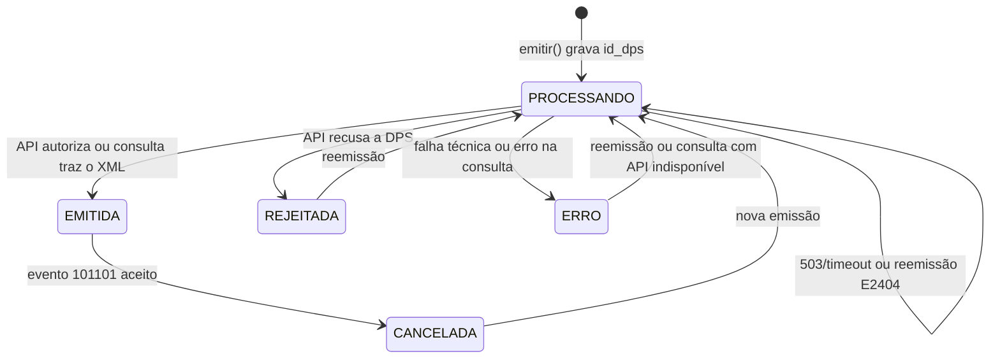
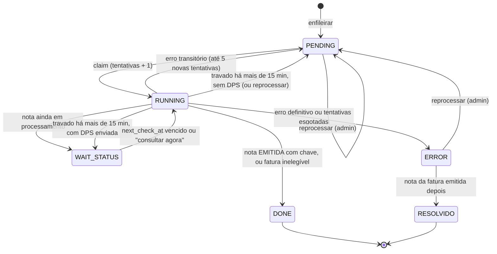
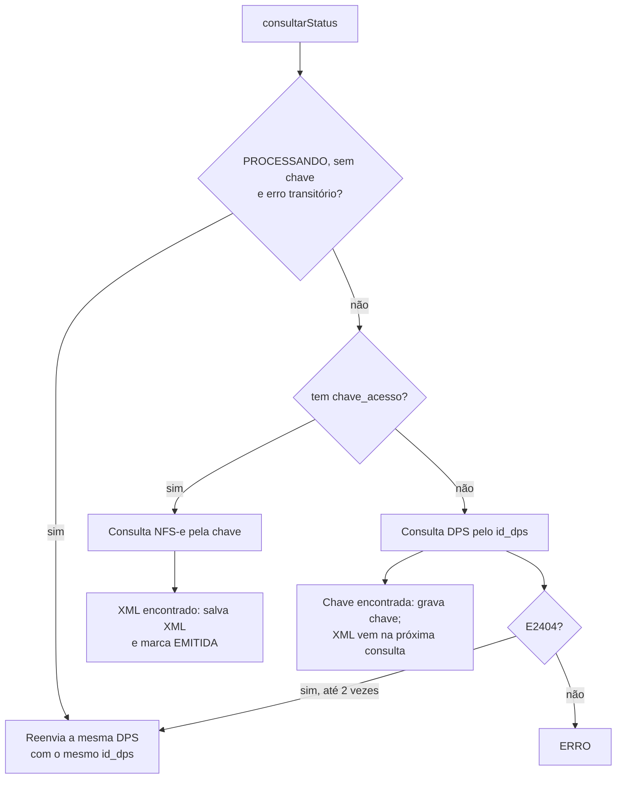
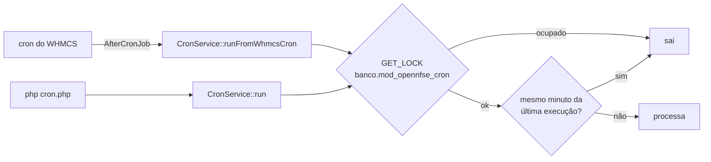

# Fluxos do OpenNfse

Como o addon emite, consulta, cancela e entrega as NFS-e. As classes citadas estão descritas em [ARQUITETURA.md](ARQUITETURA.md).

## Configurações que controlam os fluxos

Todas ficam em `mod_opennfse_config` e são editadas em **Addons > OpenNfse > Configuração**.

| Campo | Padrão | Efeito |
|---|---|---|
| `queue_enabled` | `0` | Liga a fila. Sem ela, a emissão manual é síncrona e o cron não processa nada além de limpeza e checagem de atualização. |
| `auto_emit_on_payment` | `0` | Enfileira a emissão quando a fatura é paga (exige `queue_enabled`). |
| `allow_manual_unpaid` | `0` | Permite enfileirar manualmente faturas `Unpaid` (exige `queue_enabled`). |
| `auto_send_nfse_email` | `0` | Envia XML e PDF ao cliente quando a fila conclui a nota como `DONE`. |
| `queue_wait_status_interval_seconds` | `120` | Intervalo base entre consultas de itens em `WAIT_STATUS` (limitado entre 30 e 3600 s). |
| `logs_retention_days` | `90` | Dias de retenção de `mod_opennfse_logs` (`0` desativa a limpeza). |
| `queue_done_retention_days` | `30` | Dias de retenção dos itens `DONE` e `RESOLVIDO` da fila (`0` desativa a limpeza). |

A habilitação por gateway fica em `mod_opennfse_payment_gateway_settings`. Sem nenhuma linha salva, todos os gateways são aceitos. Com pelo menos uma linha, ela vira uma lista de permitidos: o gateway precisa estar marcado, e um gateway ausente da lista fica bloqueado. Faturas sem `paymentmethod` não são bloqueadas por essa regra.

## Estados

### Estados da nota

Uma linha por fatura em `mod_opennfse_notas` (`NfseService`):

- `PROCESSANDO`: DPS gravada com `id_dps` e enviada, sem resultado final. Também indica API indisponível com reenvio pendente (o motivo fica em `erro_api`).
- `EMITIDA`: NFS-e autorizada. Quando a API não devolve a chave na hora, a nota pode ficar `EMITIDA` sem `chave_acesso` até a consulta recuperá-la.
- `REJEITADA`: a API recusou a DPS (`NfseApiException`).
- `ERRO`: falha técnica na emissão ou erro na consulta de status.
- `CANCELADA`: cancelamento registrado.

Toda emissão e cancelamento também é gravado em `mod_opennfse_notas_history` (`FiscalHistoryRepository`), porque uma reemissão sobrescreve a linha da nota.

### Estados da fila

Itens de `mod_opennfse_queue` (`QueueService` e `QueueRepository`):

- `PENDING`: aguardando processamento.
- `RUNNING`: em execução (emissão ou consulta).
- `WAIT_STATUS`: DPS enviada, aguardando a consulta. O próximo horário fica em `next_check_at`.
- `DONE`: concluído. Inclui faturas descartadas por elegibilidade, como não paga, paga só com crédito ou gateway desabilitado. O motivo vai para o log (`QUEUE_SKIP_*`).
- `ERROR`: falha definitiva. A mensagem fica em `last_error`.
- `RESOLVIDO`: item `ERROR` de uma fatura cuja nota foi emitida depois, por outro caminho. A troca é feita na emissão bem-sucedida e no início de cada lote da fila.

Uma fatura só tem um item ativo (`PENDING`, `RUNNING` ou `WAIT_STATUS`) por vez: `QueueRepository::enqueue()` ignora o pedido se já houver um (log `QUEUE_ENQUEUE_SKIP_ACTIVE`). `QueueService::enqueueEmit()` faz essa checagem e a inclusão sob o lock da fatura (ver [Locks](#locks)).

### Item preso em `RUNNING`

No início de cada processamento da fila (`processBatch`, sempre sob o lock do cron), os itens em `RUNNING` há mais de 15 minutos, medidos pela `ultima_tentativa` gravada no claim, são devolvidos (log `QUEUE_RUNNING_RECOVERED`, regras em `QueueStatePolicy`):

- `WAIT_STATUS`, se a nota já está `PROCESSANDO` com `id_dps` (ou `EMITIDA` sem chave). A consulta resolve, sem gerar nova DPS, e o item continua contando como em voo para o processamento sequencial;
- `ERROR`, se as tentativas automáticas já se esgotaram;
- `PENDING`, nos demais casos. O claim seguinte reavalia a nota antes de emitir.

## Emissão

### Emissão manual pelo admin

Botão **Emitir NFS-e** na fatura (`InvoiceHook` → action `emit` → `NotasController::emit()`):

1. Bloqueia se a fatura já tem nota vinculada: `id_dps` ou chave preenchidos, ou status `PROCESSANDO`, `EMITIDA`, `ERRO` ou `REJEITADA`. Nesses casos, use **Consultar Status**, a fila ou **Reemitir**. Nota `CANCELADA` permite nova emissão.
2. Exige fatura `Paid`. A exceção é a fatura `Unpaid` com `allow_manual_unpaid = 1` e `queue_enabled = 1` (ver [Enfileiramento manual de fatura Unpaid](#enfileiramento-manual-de-fatura-unpaid)).
3. Bloqueia pagamento só com crédito e gateway desabilitado.
4. Com a fila ligada, cria um item `PENDING` (log `QUEUE_EMIT_MANUAL`), e a emissão acontece no próximo processamento. Com a fila desligada, chama `NfseService::emitir()` na hora.

### `NfseService::emitir()`

0. Obtém o lock da fatura (espera até 5 s; sem ele, aborta com "emissão desta fatura já em andamento", log `EMISSAO_LOCK_BUSY`) e, com o lock, relê a nota: bloqueia se ela já está `EMITIDA`, se há outra DPS em `PROCESSANDO` ou, no reenvio da mesma DPS, se o `id_dps` mudou (log `EMISSAO_BLOCKED_STATUS`). O lock é liberado no fim da emissão.
1. Revalida a elegibilidade (`EmissionEligibilityService`) e roda a validação preventiva (`EmissionPreValidationService`): certificado, CNPJ, código IBGE, série, código de serviço, IM, regime do Simples, total e itens da fatura, nome, e-mail, país e documento do tomador, e endereço do tomador no exterior. Os erros são reunidos numa mensagem única.
2. Lê o CPF/CNPJ do tomador brasileiro no custom field configurado.
3. Obtém o número da DPS em `mod_opennfse_sequences` (transação com `lockForUpdate`, por ambiente, CNPJ e série). No reenvio da mesma DPS, o número é extraído do `id_dps` existente.
4. Monta a DPS (`DpsBuilderService`) e grava a nota como `PROCESSANDO` com `id_dps`, limpando chave, XML e erro anteriores.
5. Registra o log `EMISSAO_REQUEST` e envia pela SDK (`NfsePhpSdkAdapter::emitir()`).
6. Resultado:
   - **Sucesso**: salva o XML, extrai número, competência e data de emissão, marca `EMITIDA`, grava o histórico fiscal, passa os itens `ERROR` da fatura para `RESOLVIDO` e anota na fatura.
   - **Indisponibilidade transitória** (503, timeout, falha de conexão; ver [503 e timeout](#indisponibilidade-da-api-503-e-timeout)): mantém `PROCESSANDO` com o erro em `erro_api`.
   - **Erro da API**: `REJEITADA`.
   - **Erro técnico**: `ERRO`.

### Reemissão

Botão **Reemitir NFS-e** (`NotasController::reemitir()`), disponível quando a nota não está `EMITIDA` nem `PROCESSANDO`:

- Bloqueia se a fatura já tem item ativo na fila ou se o gateway está desabilitado.
- Com a fila ligada, enfileira (`QUEUE_REEMITIR_ADMIN`). Sem fila, chama `emitir()` na hora.
- A reemissão gera uma DPS nova, com o próximo número da sequência.

### Emissão automática ao pagar

Hook `InvoicePaid` → `InvoicePaidHook::handle()`:

1. Só age com `queue_enabled = 1` e `auto_emit_on_payment = 1`.
2. Aplica a elegibilidade: fatura `Paid`, pagamento que não seja só com crédito e gateway habilitado. Se a fatura não passar, registra `QUEUE_SKIP_NOT_PAID`, `QUEUE_SKIP_CREDIT_PAYMENT` ou `QUEUE_SKIP_GATEWAY_DISABLED` e não enfileira.
3. Enfileira com `allow_unpaid = 0` (log `QUEUE_ENQUEUE_AUTO_PAID`).

A emissão acontece no próximo processamento da fila (cron ou **Processar agora**).

### Enfileiramento manual de fatura Unpaid

Com `allow_manual_unpaid = 1` e a fila ligada, o botão **Emitir NFS-e** aceita fatura `Unpaid` e cria o item com `allow_unpaid = 1`. Na hora de processar, a fila só ignora a exigência de `Paid` se as três condições continuarem verdadeiras: a configuração ainda ligada, a fatura ainda `Unpaid` e o item com `allow_unpaid` igual a `1` ou nulo. As demais regras (crédito e gateway) continuam valendo. A emissão automática ao pagar sempre grava `allow_unpaid = 0`.

## Processamento da fila

`QueueService::processBatch()` roda pelo cron (lote de 20) e pelo botão **Processar agora** da tela da fila (lote de 10). Não faz nada com `queue_enabled = 0`. A ordem é:

1. Marca como `RESOLVIDO` os itens `ERROR` de faturas que já têm nota `EMITIDA` com chave.
2. **Consultas** (`processStatusBatch`): pega os itens `WAIT_STATUS` com `next_check_at` vencido, passa para `RUNNING` e chama `consultarStatus()`. Depois:
   - nota `EMITIDA` com chave → `DONE` (e envio automático de e-mail, se ligado);
   - nota ainda em processamento → volta para `WAIT_STATUS`, com intervalo `base × 2^min(consultas, 5)`, limitado a 3600 s;
   - outro status → `ERROR`;
   - exceção transitória → `WAIT_STATUS` com o mesmo backoff; exceção definitiva → `ERROR`.
3. **Emissões** (`processEmissaoBatch`), uma DPS por vez (ver abaixo).

### Processamento sequencial de DPS

A fila só envia uma nova DPS quando não há nenhum item em voo, ou seja, nenhum item `RUNNING` ou `WAIT_STATUS` (`QueueRepository::hasInFlightSequentialJob()`). Assim, a numeração da DPS segue em ordem e uma DPS pendente na API não é ultrapassada pela seguinte.

Para cada item `PENDING`, do mais antigo para o mais novo:

1. Passa para `RUNNING` e soma uma tentativa.
2. Se a nota já está `EMITIDA` com chave, marca `DONE` (`QUEUE_SKIP_ALREADY_EMITIDA`).
3. Se a nota ainda aguarda resultado, marca `WAIT_STATUS` e encerra o lote.
4. Se a fatura não é elegível, marca `DONE` com log `QUEUE_SKIP_*`.
5. Chama `NfseService::emitir()` e decide:
   - `EMITIDA` com chave → `DONE` (`QUEUE_DONE`);
   - em processamento → `WAIT_STATUS` e encerra o lote;
   - `REJEITADA`/`ERRO` → `ERROR` (`QUEUE_ERROR`).
6. Exceção: se for definitiva (`QueueErrorClassifierService::isRetryable()` falso, por exemplo erro de validação ou E2404) ou se o item já tinha 5 tentativas antes desta → `ERROR`. Caso contrário → `PENDING` (`QUEUE_RETRY`). Nos dois casos o lote é encerrado.

### Ações manuais na tela da fila

- **Consultar agora** (`filaCheckNow`): só para itens `WAIT_STATUS`. Faz a consulta na hora e aplica as mesmas regras de `DONE`/`WAIT_STATUS`/`ERROR`. Ao concluir como `DONE`, dispara o envio automático de e-mail, como no lote.
- **Reprocessar** (`filaRetry`, com confirmação): volta o item para `PENDING` com as tentativas zeradas e sem `last_error`, e ele roda no próximo ciclo com todas as tentativas automáticas de novo. Antes, grava o log `QUEUE_MANUAL_RETRY` com as tentativas e o erro anteriores e o admin. O contador de reemissão por E2404 da nota não é zerado. Permitido para `ERROR`, `PENDING` e `RUNNING` travado há mais de 15 minutos. Em `WAIT_STATUS`, use **Consultar agora**. Bloqueado para `DONE` e `RESOLVIDO`, e para um `ERROR` cuja fatura já tem outro item ativo.
- **Processar agora** (`filaProcessNow`): roda `processBatch()` com o mesmo lock do cron. Se o cron estiver rodando, responde "processamento já em andamento".

A coluna de tentativas mostra "Tentativa X de 6": a primeira tentativa mais as 5 novas tentativas automáticas.

## Consulta de status

`NfseService::consultarStatus()` é chamada pelo botão **Consultar Status**, pela fila (`WAIT_STATUS`) e pelo cron:

- **Com chave**: consulta a NFS-e. Se vier o XML, salva, extrai número e competência e marca `EMITIDA` (ou mantém `CANCELADA`, se já estava).
- **Sem chave, com `id_dps`**: consulta a DPS. Se a API devolver a chave, ela é gravada. A nota fica `PROCESSANDO`, ou continua `EMITIDA` se já estava, e o XML vem na consulta seguinte, pela chave.
- **Erro transitório na consulta**: o status é preservado e o erro é limpo. Uma nota em `ERRO` volta para `PROCESSANDO`, para ser consultada de novo.
- **Outro erro**: `ERRO`. Se a nota já estava em `ERRO` com o mesmo código de erro da API, a mensagem anterior é mantida.
- As consultas que alteram a nota atualizam `last_status_checked_at`, usado pelo cron para priorizar as notas consultadas há mais tempo.

### Indisponibilidade da API (503 e timeout)

`QueueErrorClassifierService::isTransientApiOutage()` considera transitório o erro que contém `503`, `service unavailable`, `timeout`, `timed out`, `curl error 28`, `failed to connect`, `connection refused`, `connection reset`, `could not resolve host` ou `temporarily unavailable`.

1. Se o envio da DPS falha com um desses erros, a nota fica `PROCESSANDO` com o erro em `erro_api` (sem `REJEITADA`/`ERRO`), e o item da fila vai para `WAIT_STATUS`.
2. Na consulta seguinte, a nota `PROCESSANDO` sem chave e com erro transitório não é consultada na API: o módulo **reenvia a mesma emissão, com o mesmo `id_dps`** (log `RETRY_EMISSAO_TRANSIENT_OUTAGE`). Consultar a DPS nesse momento devolveria E2404, porque a API nunca a recebeu.
3. O reenvio repete o ciclo até a API responder.

### Reemissão controlada após E2404

O E2404 ("não foi gerada uma NFS-e com o identificador de DPS informado") aparece na consulta da DPS quando a API não tem aquela DPS. Nesse caso (`NfseService::attemptE2404SameDpsReemit()`):

- se a nota tem `id_dps` e `e2404_reemit_attempts` < 2, o módulo soma uma tentativa, mantém `PROCESSANDO` e reenvia a mesma DPS com o mesmo `id_dps` (logs `E2404_REEMIT_REQUEST` e `E2404_REEMIT_RESULT`);
- depois de 2 tentativas, o E2404 marca a nota como `ERRO`, e a fila trata o erro como definitivo;
- o contador volta a zero quando a nota é emitida, quando a chave é encontrada ou numa emissão nova.

## Cron

A origem recomendada é o cron do WHMCS, pelo hook `AfterCronJob`. `cron.php` continua disponível para execução manual pela CLI. As duas origens passam pelos mesmos controles:

1. Roda as migrations pendentes e sai se não houver configuração salva.
2. Tenta o lock MySQL `<banco>.mod_opennfse_cron` sem esperar (`CronLockService`). Se outro processo está com o lock, sai e grava o log `CRON_LOCK_BUSY`, no máximo um a cada 15 minutos (`cron_lock_busy_at` na configuração).
3. **Proteção por minuto**: compara `cron_last_minute_key` (formato `YmdHi`) com o minuto atual e sai se o cron já rodou neste minuto. Depois grava `cron_last_run_at`, `cron_last_source` (`whmcs_cron` ou `standalone`) e a chave do minuto.
4. Com `queue_enabled = 1`:
   - processa a fila (`processBatch(20)`);
   - consulta até 50 notas `PROCESSANDO` (as consultadas há mais tempo primeiro), pulando faturas com item ativo na fila para não haver consulta paralela da mesma nota. Exceção na consulta marca a nota como `ERRO` (log `CRON_ERROR`);
   - consulta até 50 notas `EMITIDA` sem chave para recuperar a chave, com a mesma exclusão.
5. Verifica atualização do módulo se a última checagem tiver mais de 24 h (`UpdateCheckService`).
6. Limpa logs e itens `DONE`/`RESOLVIDO` da fila conforme a retenção configurada.
7. Libera o lock. Falhas são registradas como `CRON_ERROR` (ou `CRON_HOOK_ERROR`, quando vêm do hook).

### Locks

Todos são `GET_LOCK` do MySQL com o nome prefixado pelo banco atual (`DATABASE()`), para que duas instalações no mesmo servidor não disputem o mesmo lock. Se o nome passar de 64 caracteres, o banco é trocado por um hash curto.

| Lock | Quem usa | Espera |
|---|---|---|
| `<banco>.mod_opennfse_cron` | cron (`CronService`) e **Processar agora** | não espera |
| `<banco>.opennfse_inv_<fatura>` | `NfseService::emitir()`, `QueueService::enqueueEmit()` e **Reprocessar** | até 5 s |

O cron segura o lock do cron e, dentro do lote, cada emissão pega também o lock da fatura. Isso exige MySQL 5.7.5+ ou MariaDB 10.0.2+, que aceitam vários locks por sessão (`CronLockService::supportsMultipleLocks()`, pela `VERSION()`, lida uma vez por request). Em versões anteriores, um `GET_LOCK` novo soltaria o lock do cron. Por isso, quando o processo já tem um lock, o lock da fatura não é pedido, e o lock do cron segue garantindo a exclusão do lote.

## Envio de XML e PDF por e-mail

`InvoiceEmailService::sendToClient()` exige nota `EMITIDA` com XML. Gera o PDF do DANFS-e na hora, monta assunto e corpo (`EmailTemplateService`) e envia ao e-mail do cliente com o XML e o PDF anexados. O resultado vai para os logs (`EMAIL_NFSE_*`) e para as notas da fatura.

Pontos de disparo:

- **Manual, pelo admin**: botão **Enviar por e-mail** na fatura (action `sendEmail`).
- **Manual, pelo cliente**: botão na fatura e na lista da área do cliente.
- **Automático após `DONE`**: com `auto_send_nfse_email = 1`, a fila envia o e-mail sempre que marca um item como `DONE` com a nota emitida, na emissão, na consulta `WAIT_STATUS` do processamento em lote ou no **Consultar agora**.

Proteção contra duplicidade no envio automático (`NotaRepository::claimAutomaticEmail()`): antes de enviar, o módulo preenche `email_automatico_processado_at` com um `UPDATE ... WHERE email_automatico_processado_at IS NULL`. Só o processo que conseguir essa atualização envia. O resultado fica em `email_automatico_status` (`PROCESSANDO`, `ENVIADO` ou `FALHOU`). Uma falha é registrada em `EMAIL_NFSE_AUTO_ERROR` e nas notas da fatura, e não há nova tentativa automática. O reenvio manual continua disponível.

## Cancelamento

Botão **Cancelar NFS-e** na fatura → formulário (`cancelForm`) → `cancel` (`POST`) → `NfseService::cancelarNfse()`:

1. Exige nota `EMITIDA` com chave de acesso e CNPJ do emissor válido.
2. Código do motivo (`cMotivo`): `1`, `2` ou `9` (o valor `3` é convertido para `9`).
3. `xMotivo` é composto como "motivo - descrição" e precisa ter de 15 a 255 caracteres. `xDesc` é fixo: "Cancelamento de NFS-e".
4. Monta o evento `101101` (`PedRegEventoData`), registra `CANCELAMENTO_REQUEST` e envia pela SDK.
5. **Sucesso**: salva o XML do evento como `cancelamento_nfse_...xml`, marca `CANCELADA`, grava `cancelado_em`, os dados do motivo e o histórico fiscal, e anota na fatura.
6. **Falha**: grava o erro em `cancel_erro` e mantém o status da nota.

### Cancelamento de XML órfão

No relatório **Auditoria XML**, um XML de NFS-e salvo em disco mas sem vínculo com a nota atual da fatura pode ser cancelado (`cancelOrphanXml` → `NfseService::cancelarNfseOrfaPorXmlPath()`). A chave vem do XML ou, se faltar, da consulta da DPS. O módulo recusa o cancelamento se o histórico fiscal já tiver cancelamento para aquela chave. O resultado vai para o histórico fiscal e para as notas da fatura, sem alterar a nota atual.

## Área do cliente

- **Menu**: item **Notas Fiscais** no menu Billing (`index.php?m=OpenNfse`). Lista até 50 notas `EMITIDA` com XML das faturas do cliente logado, com aviso configurável no topo (`client_area_notice_*`).
- **Fatura**: o hook `ClientAreaPageViewInvoice` mostra status, número, data de emissão ou cancelamento e chave da NFS-e. Com a nota `EMITIDA`, mostra os botões de XML, PDF e e-mail. Com `ERRO` ou `REJEITADA`, mostra o detalhe do erro.
- **Ações** (`downloadXml`, `downloadPdf`, `sendEmail`): só por `POST`, com token CSRF e conferindo se a fatura pertence ao cliente logado. Download exige nota `EMITIDA`.

## Relatórios

Em **Addons > OpenNfse > Relatórios** (`ReportsController`), por abas:

- **NFS-e Emitidas**: notas emitidas e canceladas no período, com totais, ações por nota (consultar, reemitir, cancelar) e ZIP dos XMLs. O ZIP por competência separa os arquivos em `Emitidas/`, `Canceladas/` e `Emitidas para Estrangeiros/`.
- **Falhas** e **Cancelamentos**.
- **Auditoria Emissão**: faturas pagas em gateways ativos que não geraram NFS-e nem entraram na fila.
- **Auditoria XML**: compara a pasta mensal de XMLs com o `xml_path` das notas para achar órfãos e referências inconsistentes.
- **Auditoria DPS > API**: confere na API as DPS da competência e procura lacunas na sequência (`DpsApiAuditService`, processada em lotes).
- **Auditoria API**: sincroniza a distribuição de documentos por NSU (`ApiAuditService`). Não aparece no menu lateral; abre por `tab=auditoria_api`.
- **Histórico Fiscal**: emissões, cancelamentos e snapshots de cada fatura ao longo do tempo.
- **Logs**: logs técnicos com visualização detalhada (`logView`).

Exportação CSV disponível para as abas Emitidas, Falhas, Cancelamentos, Auditoria Emissão e Logs (`relatoriosExport`), e ZIP de XMLs pela aba Emitidas (`relatoriosExportZip`).
