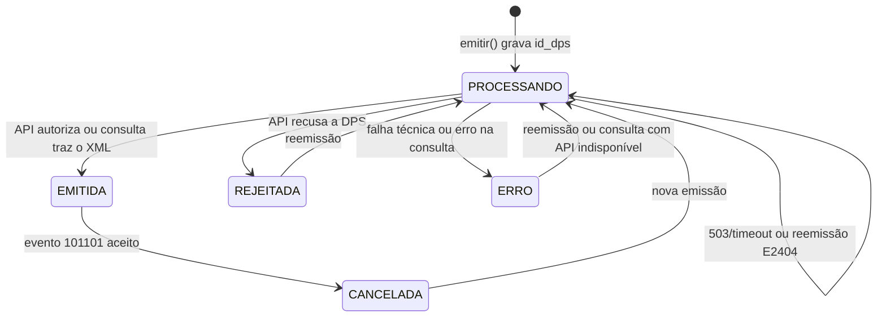
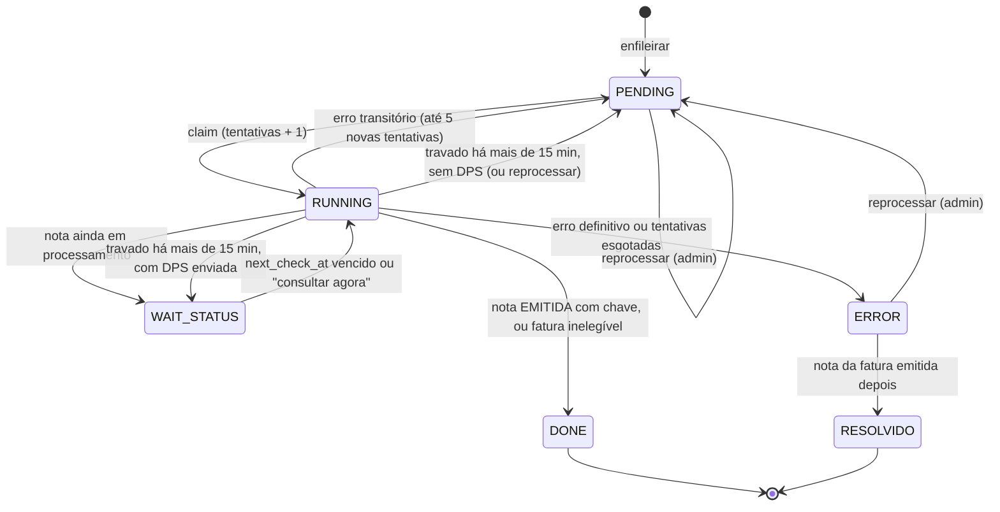
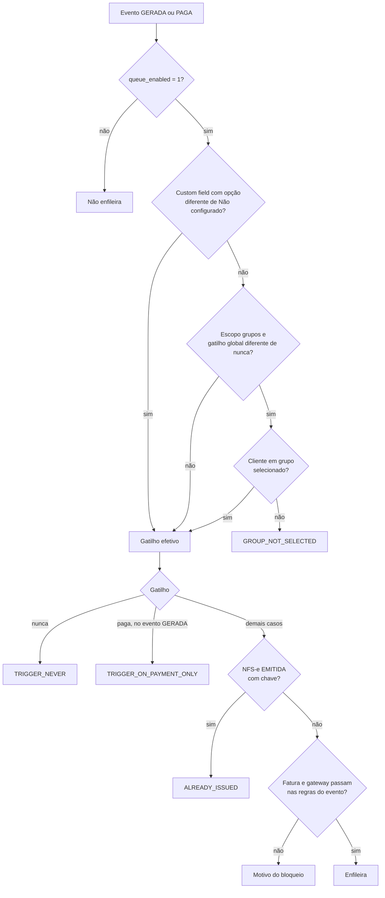
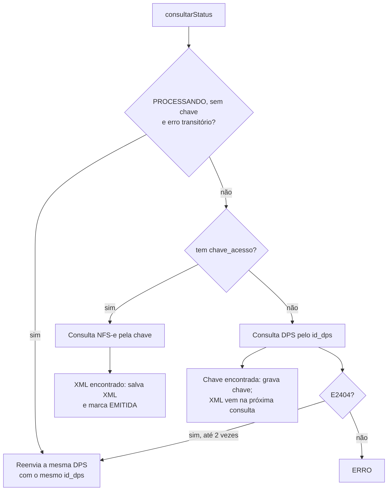
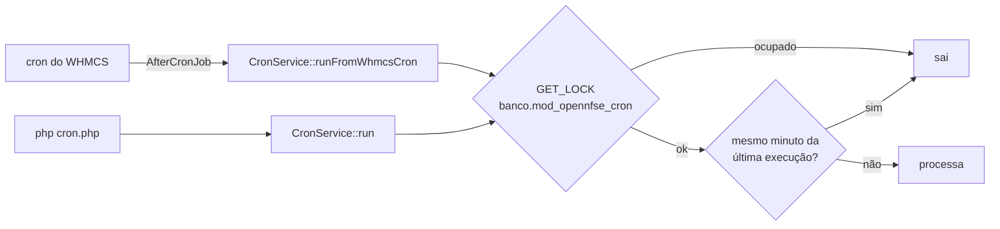

# Fluxos do OpenNfse

Como o addon emite, consulta, cancela e entrega as NFS-e. As classes citadas estão descritas em [ARQUITETURA.md](ARQUITETURA.md).

## Configurações que controlam os fluxos

Todas ficam em `mod_opennfse_config` e são editadas em **Addons > OpenNfse > Configuração**.

| Campo | Padrão | Efeito |
|---|---|---|
| `dps_leiaute` | `auto` | Leiaute da DPS (seção Ambiente): `auto` segue a NT 009 (homologação já no leiaute novo; produção a partir de 01/12/2026 00:00, horário de Brasília), `pre_nt009` e `nt009` forçam um leiaute. Ver [LEVANTAMENTO_API_NACIONAL.md](LEVANTAMENTO_API_NACIONAL.md#leiaute-da-dps-nt-009). |
| `queue_enabled` | `0` | Liga a fila. Com a fila desligada, o cron faz as novas tentativas do e-mail automático, a conferência diferida dos alertas, a limpeza e a checagem de atualização, e a emissão manual é síncrona. |
| `auto_emit_trigger` | `nunca` | **Enfileirar emissão automaticamente quando?** `nunca`, `paga` (quando a fatura é paga) ou `gerada` (quando a fatura `Unpaid` é publicada e, se ainda não houver NFS-e, também no pagamento). Exige `queue_enabled`. Ver [Política de emissão automática](#política-de-emissão-automática). |
| `auto_emit_scope` | `todos` | **Aplicar a regra a quais clientes?** `todos` ou `grupos` (só os clientes dos grupos de `auto_emit_group_ids`). |
| `auto_emit_group_ids` | vazio | IDs de `tblclientgroups` separados por vírgula. Com `auto_emit_scope = grupos` e gatilho diferente de `nunca`, é preciso marcar pelo menos um grupo. |
| `auto_emit_customfield_id` | `0` | Custom field de cliente que define a regra por cliente (`0` desliga). Exige `queue_enabled`. Ver [Custom field por cliente](#custom-field-por-cliente). |
| `auto_emit_on_payment` | `0` | Configuração anterior a `auto_emit_trigger`. Fica gravada como espelho (`1` quando o gatilho não é `nunca`) e só é lida quando `auto_emit_trigger` não tem valor válido: `1` vale como `paga`, `0` como `nunca`. Não aparece mais na tela. |
| `allow_manual_unpaid` | `0` | Permite enfileirar pelo botão **Emitir NFS-e** faturas `Unpaid` (exige `queue_enabled`). Vale independente do gatilho automático, do grupo e do custom field do cliente. |
| `auto_send_nfse_email` | `0` | Envia XML e PDF ao cliente uma vez por nota, quando ela passa a `EMITIDA` com chave de acesso, com ou sem fila. Ver [Envio automático](#envio-automático). |
| `queue_wait_status_interval_seconds` | `120` | Intervalo base entre consultas de itens em `WAIT_STATUS` (limitado entre 30 e 3600 s). |
| `logs_retention_days` | `90` | Dias de retenção de `mod_opennfse_logs` (`0` desativa a limpeza). |
| `queue_done_retention_days` | `30` | Dias de retenção dos itens `DONE` e `RESOLVIDO` da fila (`0` desativa a limpeza). |

A habilitação por gateway fica em `mod_opennfse_payment_gateway_settings`. Sem nenhuma linha salva, todos os gateways são aceitos. Com pelo menos uma linha, ela vira uma lista de permitidos: o gateway precisa estar marcado, e um gateway ausente da lista fica bloqueado. Faturas sem `paymentmethod` não são bloqueadas por essa regra.

A mesma tabela guarda `emit_on_create` (coluna **Emitir ao gerar a fatura** na aba **Integração com WHMCS**, padrão `0`). Só os gateways marcados ali emitem na geração da fatura, e o gateway também precisa estar com a emissão de NFS-e ativada. Gateway sem linha salva, ou fatura sem `paymentmethod`, não emite na geração. A coluna não altera a emissão no pagamento nem a manual.

## Estados

### Estados da nota

Uma linha por fatura em `mod_opennfse_notas` (`NfseService`):



- `PROCESSANDO`: DPS gravada com `id_dps` e enviada, sem resultado final. Também indica API indisponível com reenvio pendente (o motivo fica em `erro_api`).
- `EMITIDA`: NFS-e autorizada. Quando a API não devolve a chave na hora, a nota pode ficar `EMITIDA` sem `chave_acesso` até a consulta recuperá-la.
- `REJEITADA`: a API recusou a DPS (`NfseApiException`).
- `ERRO`: falha técnica na emissão ou erro na consulta de status.
- `CANCELADA`: cancelamento registrado.

Toda emissão e cancelamento também é gravado em `mod_opennfse_notas_history` (`FiscalHistoryRepository`), porque uma reemissão sobrescreve a linha da nota.

### Estados da fila

Itens de `mod_opennfse_queue` (`QueueService` e `QueueRepository`):



- `PENDING`: aguardando processamento.
- `RUNNING`: em execução (emissão ou consulta).
- `WAIT_STATUS`: DPS enviada, aguardando a consulta. O próximo horário fica em `next_check_at`.
- `DONE`: concluído. Inclui faturas descartadas por elegibilidade, como não paga (inclusive a fatura cancelada depois de enfileirada na geração), paga só com crédito, de valor zero (`QUEUE_SKIP_ZERO_VALUE`) ou com gateway desabilitado, e itens da geração que a política deixou de autorizar no processamento. O motivo vai para o log (`QUEUE_SKIP_*`).
- `ERROR`: falha definitiva. A mensagem fica em `last_error`.
- `RESOLVIDO`: item `ERROR` de uma fatura cuja nota foi emitida depois, por outro caminho. A troca é feita na emissão bem-sucedida e no início de cada lote da fila.

Uma fatura só tem um item ativo (`PENDING`, `RUNNING` ou `WAIT_STATUS`) por vez: `QueueRepository::enqueue()` ignora o pedido se já houver um (log `QUEUE_ENQUEUE_SKIP_ACTIVE`). `QueueService::enqueueEmit()` faz essa checagem e a inclusão sob o lock da fatura (ver [Locks](#locks)).

A coluna `origem` guarda quem criou o item: `gerada` (geração da fatura), `paga` (pagamento) ou `manual` (botão **Emitir NFS-e**). Fica nula nos itens anteriores à coluna e na reemissão. Ela muda o processamento só para o item da geração: a fila roda de novo a política antes de emitir (ver [Processamento sequencial de DPS](#processamento-sequencial-de-dps)) e aceita a fatura `Unpaid` (ver [Enfileiramento manual de fatura Unpaid](#enfileiramento-manual-de-fatura-unpaid)).

### Item preso em `RUNNING`

No início de cada processamento da fila (`processBatch`, sempre sob o lock do cron), os itens em `RUNNING` há mais de 15 minutos, medidos pela `ultima_tentativa` gravada no claim, são devolvidos (log `QUEUE_RUNNING_RECOVERED`, regras em `QueueStatePolicy`):

- `WAIT_STATUS`, se a nota já está `PROCESSANDO` com `id_dps` (ou `EMITIDA` sem chave). A consulta resolve, sem gerar nova DPS, e o item continua contando como em voo para o processamento sequencial. Depois de 3 recuperações do mesmo item (contadas pelos logs `QUEUE_RUNNING_RECOVERED` do seu `correlation_id`, desde o último **Reprocessar**), ele vai para `ERROR`, com o motivo em `last_error`: a consulta derruba o processo sempre (erro fatal, `memory_limit` ou `max_execution_time`) e não pode travar a fila;
- `ERROR`, se as tentativas automáticas já se esgotaram;
- `PENDING`, nos demais casos. O claim seguinte reavalia a nota antes de emitir.

## Política de emissão automática

`EmissionPolicyService::decide()` decide se a fatura entra na fila em cada evento:

| Evento | Origem | Hook ou tela |
|---|---|---|
| `GERADA` | fatura `Unpaid` publicada | `InvoiceCreated` → `InvoiceCreatedHook` |
| `PAGA` | fatura paga | `InvoicePaid` → `InvoicePaidHook` |
| `MANUAL` | botão **Emitir NFS-e** | `NotasController::emit()` |

A classe não acessa o banco: `EmissionPolicyContextLoader` lê a fatura, o grupo e o custom field do cliente, os ajustes do gateway e a nota atual, e grava os avisos do custom field. A decisão volta como `EmissionDecision` (emite ou não, motivo, regra aplicada, gatilho efetivo e `allow_unpaid`).

Os eventos `GERADA` e `PAGA` passam pelo gatilho. O evento `MANUAL` não: segue `allow_manual_unpaid`, como antes (ver [Emissão manual pelo admin](#emissão-manual-pelo-admin)).

### Precedência

Nos eventos automáticos, com a fila ligada, o gatilho efetivo vem da primeira regra que decidir:

1. **Custom field do cliente**, quando `auto_emit_customfield_id` está configurado, o campo existe em `tblcustomfields` e o valor do cliente é uma opção diferente de "Não configurado" (regra `customfield`). Vale mesmo para cliente fora dos grupos selecionados.
2. **Grupo de clientes**, quando `auto_emit_scope = grupos` e o gatilho global não é `nunca` (regra `grupo`). Cliente sem grupo, ou fora dos grupos de `auto_emit_group_ids`, não emite automaticamente (motivo `GROUP_NOT_SELECTED`). Cliente de um grupo selecionado segue o gatilho global.
3. **Regra global**: `auto_emit_trigger` (regra `global`).



### Evento × gatilho

| Gatilho efetivo | Geração da fatura | Pagamento da fatura |
|---|---|---|
| `nunca` | não enfileira | não enfileira |
| `paga` | não enfileira | enfileira |
| `gerada` | enfileira, se o gateway está marcado em **Emitir ao gerar a fatura** | enfileira, se ainda não há NFS-e `EMITIDA` com chave |

Nos dois eventos, a fatura que já tem NFS-e `EMITIDA` com chave não é enfileirada (motivo `ALREADY_ISSUED`). Nota em `PROCESSANDO`, ou `EMITIDA` sem chave, não conta como emitida: o item é criado, e a fila só consulta o status.

Regras da fatura em cada evento:

- **Geração**: fatura `Unpaid` (não vale para `Draft`, `Paid` ou `Cancelled`), total maior que zero, sem pagamento só com crédito, sem item de Mass Pay ou Add Funds, gateway com a emissão de NFS-e ativada e marcado em **Emitir ao gerar a fatura**.

  A fatura com item `type = 'Invoice'` em `tblinvoiceitems` é um pagamento em massa (Mass Pay): agrupa outras faturas, e emitir nela duplicaria a nota das faturas agrupadas (motivo `MASS_PAY`). A fatura com item `type = 'AddFunds'` é uma adição de crédito que ainda não foi recebida (motivo `ADD_FUNDS`). As duas não são enfileiradas na geração e seguem só pela regra do pagamento, sem mudança.
- **Pagamento**: fatura `Paid`, sem pagamento só com crédito, com valor maior que zero e gateway com a emissão de NFS-e ativada.
- **Pagamento e emissão manual**: a fatura de Mass Pay (com item `type = 'Invoice'`, cujo `relid` aponta a fatura original) não emite se qualquer fatura original já tem nota `EMITIDA` ou `PROCESSANDO` em `mod_opennfse_notas` (motivo `MASS_PAY_CHILD_ALREADY_ISSUED`). As faturas originais são quitadas com crédito pela Mass Pay e podem ter tido a nota emitida na geração; emitir também na agregadora, paga pelo gateway, duplicaria a nota do mesmo serviço. Se nenhuma fatura original tem nota, a agregadora emite como antes. Para emitir na agregadora mesmo assim, cancele antes as notas das faturas originais.

A fatura de valor zero (total menor ou igual a zero, sem crédito aplicado) é descartada na elegibilidade (`EmissionEligibilityService::SKIP_ZERO_VALUE`, motivo `ZERO_VALUE`) no pagamento, na emissão manual e no processamento da fila, porque não há serviço a declarar. Com crédito aplicado e total zero, continua valendo a regra do pagamento só com crédito. Na geração, o motivo é `INVOICE_ZERO_TOTAL`.

### Custom field por cliente

O custom field permite definir a regra de cada cliente. Para criar:

1. No WHMCS, abra **Setup > Custom Client Fields** (Configurações > Campos personalizados do cliente).
2. Crie o campo com **Field Type: Drop Down** e marque **Admin Only**, para o cliente não alterar o valor.
3. Em **Select Options**, informe exatamente estas opções, separadas por vírgula:

   ```text
   Não configurado,Não emitir automaticamente,Emitir apenas manualmente,Emitir apenas de faturas pagas,Emitir de todas as faturas
   ```

4. Em **Addons > OpenNfse > Configuração**, aba **Processamento Automático**, selecione o campo em **Enfileirar emissão de acordo com o custom field do cliente**.

| Opção | Gatilho efetivo |
|---|---|
| Não configurado | segue o grupo e a regra global |
| Não emitir automaticamente | `nunca`: sem emissão automática na geração e no pagamento |
| Emitir apenas manualmente | `nunca`: mesmo efeito da opção anterior |
| Emitir apenas de faturas pagas | `paga` |
| Emitir de todas as faturas | `gerada` (a geração ainda depende de **Emitir ao gerar a fatura** no gateway) |

O valor é comparado com as opções sem diferenciar maiúsculas de minúsculas e ignorando acentos e espaços extras, dos dois lados: "Nao emitir automaticamente" e "NÃO EMITIR AUTOMATICAMENTE" valem como "Não emitir automaticamente".

Valor vazio, ou cliente sem valor gravado, é tratado como "Não configurado", sem log: é o caso normal de quem não tem regra própria. Valor preenchido que não corresponde a nenhuma opção também é tratado como "Não configurado" e gera o aviso `CUSTOMFIELD_UNKNOWN_VALUE` no log `POLICY_CUSTOMFIELD_WARNING` (com fatura, evento e código do aviso) a cada evento avaliado.

Se o campo selecionado em `auto_emit_customfield_id` for apagado no WHMCS (não existe mais em `tblcustomfields` com `type = 'client'`), a regra por cliente é ignorada e todos os clientes seguem o grupo e a regra global, sem log por cliente nem por evento. A tela de configuração (seção **Emissão automática**) e o dashboard do addon mostram o aviso: "O custom field configurado para a emissão automática não existe mais; a regra por cliente está sendo ignorada."

"Não emitir automaticamente" e "Emitir apenas manualmente" ficam como opções separadas por compatibilidade com o dropdown proposto na issue #3. As duas bloqueiam toda emissão automática do cliente, e nenhuma delas bloqueia o botão **Emitir NFS-e**: a emissão manual não depende de gatilho, grupo nem custom field.

### Logs da política

Quando a política não enfileira, o hook grava um log com o motivo:

| Motivo | Evento | Quando | Log |
|---|---|---|---|
| `QUEUE_DISABLED` | ambos | fila desligada | nenhum |
| `TRIGGER_NEVER` | ambos | gatilho `nunca` | nenhum na regra global; `QUEUE_SKIP_POLICY` quando vem do custom field |
| `TRIGGER_ON_PAYMENT_ONLY` | geração | gatilho `paga` | nenhum, em qualquer regra: a decisão fica para o pagamento |
| `GROUP_NOT_SELECTED` | ambos | cliente fora dos grupos selecionados | `QUEUE_SKIP_POLICY` |
| `ALREADY_ISSUED` | ambos | NFS-e `EMITIDA` com chave | `QUEUE_SKIP_POLICY` |
| `INVOICE_NOT_UNPAID` | geração | fatura não está `Unpaid` | nenhum quando a fatura já está `Paid` (o pagamento é tratado pelo `InvoicePaid`); `QUEUE_SKIP_POLICY` nos demais status, como `Cancelled` |
| `INVOICE_ZERO_TOTAL` | geração | total zero | `QUEUE_SKIP_POLICY` |
| `CREDIT_PAYMENT` | geração | pagamento só com crédito | `QUEUE_SKIP_POLICY` |
| `GATEWAY_DISABLED` | geração | gateway com a emissão de NFS-e desativada | `QUEUE_SKIP_POLICY` |
| `GATEWAY_NOT_ON_CREATE` | geração | gateway não marcado em **Emitir ao gerar a fatura** | `QUEUE_SKIP_POLICY` |
| `MASS_PAY` | geração | fatura de pagamento em massa (item `type = 'Invoice'`) | `QUEUE_SKIP_POLICY` |
| `ADD_FUNDS` | geração | adição de crédito (item `type = 'AddFunds'`) | `QUEUE_SKIP_POLICY` |
| `NOT_PAID` | pagamento | fatura não está `Paid` | `QUEUE_SKIP_NOT_PAID` |
| `ZERO_VALUE` | pagamento | total menor ou igual a zero, sem crédito aplicado | `QUEUE_SKIP_ZERO_VALUE` |
| `MASS_PAY_CHILD_ALREADY_ISSUED` | pagamento | Mass Pay com fatura original que já tem nota `EMITIDA` ou `PROCESSANDO` | `QUEUE_SKIP_POLICY` |
| `CREDIT_PAYMENT` | pagamento | pagamento só com crédito | `QUEUE_SKIP_CREDIT_PAYMENT` |
| `GATEWAY_DISABLED` | pagamento | gateway com a emissão de NFS-e desativada | `QUEUE_SKIP_GATEWAY_DISABLED` |

O `QUEUE_SKIP_POLICY` traz a fatura, o evento, o motivo, a regra aplicada (`customfield`, `grupo` ou `global`), o gatilho efetivo e `allow_unpaid`, com a explicação em texto. Quando a regra global desliga a automação, nada é logado, como antes.

A fila também grava `QUEUE_SKIP_POLICY` quando reavalia o item da geração e a política não autoriza mais a emissão. Nesse caso, o log traz `queue_id`, a fatura, o evento `GERADA`, o motivo, a regra aplicada e o gatilho efetivo, e o item vai para `DONE` (ver [Processamento sequencial de DPS](#processamento-sequencial-de-dps)).

### Atualização de versões anteriores

A migration `040` cria `auto_emit_trigger`, `auto_emit_scope`, `auto_emit_group_ids` e `auto_emit_customfield_id`, e preenche o gatilho a partir de `auto_emit_on_payment`: `paga` quando estava `1`, `nunca` nos demais casos. O `UPDATE ... WHERE auto_emit_trigger IS NULL` só preenche o que está vazio, então rodar de novo não muda nada. As migrations `039` (coluna `origem` da fila) e `041` (`emit_on_create` dos gateways) criam as colunas com o valor nulo ou `0`.

No upgrade, ninguém muda de comportamento: quem emitia no pagamento continua no pagamento, o escopo fica `todos`, o custom field fica desligado e nenhum gateway fica marcado para emitir na geração.

Ao salvar a configuração, `auto_emit_on_payment` é gravado como `1` sempre que o gatilho não é `nunca`. Gatilho diferente de `nunca`, ou custom field configurado, exige a fila ligada.

### Aviso fiscal

Ao escolher o gatilho `gerada`, ou com o custom field configurado, a tela mostra um aviso: a NFS-e é emitida antes do pagamento, o ISS é devido mesmo que a fatura nunca seja paga, a competência é a data de emissão e o prazo do município para cancelar a NFS-e é curto. Se a fatura for cancelada ou alterada depois da emissão, o cancelamento da NFS-e continua manual (ver [Cancelamento](#cancelamento)).

## Emissão

### Emissão manual pelo admin

Botão **Emitir NFS-e** na fatura (`InvoiceHook` → action `emit` → `NotasController::emit()`):

1. Bloqueia se a fatura já tem nota vinculada: `id_dps` ou chave preenchidos, ou status `PROCESSANDO`, `EMITIDA`, `ERRO` ou `REJEITADA`. Nesses casos, use **Consultar Status**, a fila ou **Reemitir**. Nota `CANCELADA` permite nova emissão.
2. Aplica a política com o evento `MANUAL`, que não depende do gatilho automático, do grupo nem do custom field do cliente. Exige fatura `Paid`. A exceção é a fatura `Unpaid` com `allow_manual_unpaid = 1` e `queue_enabled = 1` (ver [Enfileiramento manual de fatura Unpaid](#enfileiramento-manual-de-fatura-unpaid)).
3. Bloqueia pagamento só com crédito, gateway desabilitado e fatura de valor zero ("Fatura com valor zero: não há serviço a declarar na NFS-e."). Bloqueia também a fatura de Mass Pay cujas faturas originais já têm nota `EMITIDA` ou `PROCESSANDO` (motivo `MASS_PAY_CHILD_ALREADY_ISSUED`), com a mensagem "Esta fatura de pagamento em massa (Mass Pay) agrupa faturas que já têm NFS-e emitida ou em processamento. Emitir outra NFS-e aqui duplicaria a nota do mesmo serviço." Nesse caso, se for preciso emitir na agregadora, cancele antes as notas das faturas originais.
4. Com a fila ligada, cria um item `PENDING` com origem `manual` (log `QUEUE_EMIT_MANUAL`), e a emissão acontece no próximo processamento. Com a fila desligada, chama `NfseService::emitir()` na hora.

### `NfseService::emitir()`

0. Obtém o lock da fatura (espera até 5 s; sem ele, aborta com "emissão desta fatura já em andamento", log `EMISSAO_LOCK_BUSY`) e, com o lock, relê a nota: bloqueia se ela já está `EMITIDA`, se há outra DPS em `PROCESSANDO` ou, no reenvio da mesma DPS, se o `id_dps` mudou (log `EMISSAO_BLOCKED_STATUS`). O lock é liberado no fim da emissão.
1. Revalida a elegibilidade (`EmissionEligibilityService`) e roda a validação preventiva (`EmissionPreValidationService`): regime especial de tributação (`7`, `8` e `10` bloqueiam a emissão com mensagem própria), certificado, CNPJ, código IBGE, série, código de serviço, IM, regime do Simples, total e itens da fatura, nome, e-mail, país e documento do tomador, e endereço do tomador no exterior. Os erros são reunidos numa mensagem única. A fatura de valor zero sem crédito aplicado é descartada antes, na elegibilidade: na emissão direta (fila desligada) grava `EMISSAO_SKIP_ZERO_VALUE`, e na fila o item vai para `DONE` com `QUEUE_SKIP_ZERO_VALUE`, em vez de cair como `ERRO` na validação preventiva.
2. Lê o CPF/CNPJ do tomador brasileiro no custom field configurado.
3. Obtém o número da DPS em `mod_opennfse_sequences` (transação com `lockForUpdate`, por ambiente, CNPJ e série). No reenvio da mesma DPS, o número é extraído do `id_dps` existente.
4. Monta a DPS (`DpsBuilderService`) no leiaute ativo (`DpsLayoutService`) e grava a nota como `PROCESSANDO` com `id_dps`, limpando chave, XML e erro anteriores.
5. Registra o log `EMISSAO_REQUEST` e envia pela SDK (`NfsePhpSdkAdapter::emitir()`).
6. Resultado:
   - **Sucesso**: salva o XML, extrai número, competência e data de emissão, marca `EMITIDA`, grava o histórico fiscal, passa os itens `ERROR` da fatura para `RESOLVIDO` e anota na fatura. Depois de liberar o lock da fatura, dispara o [envio automático](#envio-automático) do e-mail.
   - **Indisponibilidade transitória** (503, timeout, falha de conexão; ver [503 e timeout](#indisponibilidade-da-api-503-e-timeout)): mantém `PROCESSANDO` com o erro em `erro_api`.
   - **Erro da API**: `REJEITADA`. Se for um E1235 por leiaute (erro de estrutura do schema com `cLocEmi` ou `finNFSe` fora do lugar), o `erro_api` começa com: "Rejeição de leiaute da DPS (E1235): foi enviado o leiaute X e a SEFIN espera o leiaute Y. Ajuste "Leiaute da DPS" em Configurações > Ambiente e reenvie a nota.", seguido do detalhe da API.
   - **Erro técnico**: `ERRO`.

### Reemissão

Botão **Reemitir NFS-e** (`NotasController::reemitir()`), disponível quando a nota não está `EMITIDA` nem `PROCESSANDO`:

- Bloqueia se a fatura já tem item ativo na fila ou se o gateway está desabilitado.
- Com a fila ligada, enfileira (`QUEUE_REEMITIR_ADMIN`). Sem fila, chama `emitir()` na hora.
- Quando a fatura já tem item ativo, inclusive se outro pedido o criou no instante do enfileiramento, a reemissão não é registrada: grava o log `ADMIN_REEMITIR_BLOCKED` com motivo `active_queue` e mostra ao admin o aviso de item já ativo na fila.
- A reemissão gera uma DPS nova, com o próximo número da sequência.

### Emissão automática na geração da fatura

Hook `InvoiceCreated` → `InvoiceCreatedHook::handle()`. O WHMCS dispara o hook quando a fatura sai de `Draft` e fica disponível ao cliente, seja na geração automática, pelo admin ou pela API:

1. Sai sem log quando o `status` informado pelo WHMCS no hook é `Draft`. Nos demais casos, a decisão usa o status relido no banco: com crédito automático, o `InvoicePaid` pode chegar antes do `InvoiceCreated`, e a fatura já estar `Paid`. Aí a política devolve `INVOICE_NOT_UNPAID` sem log, e o pagamento é tratado pelo `InvoicePaid`.
2. Só lê fatura e cliente com `queue_enabled = 1` e alguma regra que possa emitir na geração: gatilho global `gerada` ou custom field configurado. Nos demais casos, sai sem log.
3. Aplica a política com o evento `GERADA` (ver [Política de emissão automática](#política-de-emissão-automática)). Se a política não autorizar, grava `QUEUE_SKIP_POLICY` (salvo quando a regra global desliga a automação) e não enfileira.
4. Enfileira com `allow_unpaid = 1` e origem `gerada` (log `QUEUE_ENQUEUE_AUTO_CREATED`).

Qualquer falha é registrada em `QUEUE_ENQUEUE_AUTO_CREATED_ERROR` e não interrompe a geração da fatura no WHMCS. A emissão acontece no próximo processamento da fila, com a fatura ainda `Unpaid` (ver [Enfileiramento manual de fatura Unpaid](#enfileiramento-manual-de-fatura-unpaid)).

No processamento, a fila roda de novo a política com o evento `GERADA` antes de emitir, com as mesmas regras do enfileiramento. Se algo mudou entre a geração e o processamento (o admin voltou o gatilho para `paga` ou `nunca`, desmarcou o gateway em **Emitir ao gerar a fatura**, o cliente trocou de gateway, mudou o custom field ou saiu do grupo), o item vai para `DONE` com `QUEUE_SKIP_POLICY` e a fatura segue a regra do pagamento.

Se a fatura for paga antes do processamento, o item segue o caminho normal da fatura `Paid`, sem reavaliar a política da geração. Se for cancelada, o item vira `DONE` com `QUEUE_SKIP_NOT_PAID`. A emissão na geração não muda o tratamento do pagamento pelo gateway.

No WHMCS 8.13, alguns caminhos de criação de fatura não têm o disparo do `InvoiceCreated` confirmado: publicar um rascunho sem enviar o e-mail (**Publish**), a fatura de Add Funds criada pelo admin e a divisão ou duplicação de fatura (`InvoiceSplit`). Se a nota não sair na geração nesses casos, ela sai no pagamento, porque o gatilho `gerada` também enfileira quando a fatura é paga.

#### Valor da NFS-e e valor pago

A NFS-e emitida na geração usa o valor da fatura naquele momento. Se o cliente pagar com um gateway que acrescenta taxa, juros ou multa, com desconto por antecipação, ou trocar de gateway, o valor final da fatura fica diferente do valor da nota, e o alerta "Fatura alterada com NFS-e" é aberto. Casos conhecidos:

- **PagHiper** (`paghiper` e `paghiper_pix`): no pagamento, acrescenta à fatura o item "PAGHIPER: Juros e multa por atraso", que pode incluir a taxa repassada ao cliente, ou um item negativo de desconto por pagamento antecipado.
- **MercadoPago**: não altera a fatura; desconta a taxa do valor recebido.
- **Boleto legado** (`boleto`): só altera o valor impresso no boleto; a fatura não muda.

Como não é possível saber de antemão qual gateway o cliente vai usar, a recomendação é não repassar taxas ao cliente nos gateways usados com a emissão na geração. No modo de emissão ao pagar, a nota já sai com o total final da fatura.

### Emissão automática ao pagar

Hook `InvoicePaid` → `InvoicePaidHook::handle()`:

1. Só age com `queue_enabled = 1` e alguma regra que possa emitir automaticamente: gatilho global diferente de `nunca` ou custom field configurado. Nos demais casos, sai sem log.
2. Aplica a política com o evento `PAGA` (ver [Política de emissão automática](#política-de-emissão-automática)). A regra da fatura: fatura `Paid`, pagamento que não seja só com crédito, valor maior que zero e gateway habilitado. Se a fatura não passar, registra `QUEUE_SKIP_NOT_PAID`, `QUEUE_SKIP_CREDIT_PAYMENT`, `QUEUE_SKIP_ZERO_VALUE` ou `QUEUE_SKIP_GATEWAY_DISABLED` e não enfileira. Os bloqueios por grupo, custom field, NFS-e já emitida ou Mass Pay com fatura original já emitida (`MASS_PAY_CHILD_ALREADY_ISSUED`) vão para `QUEUE_SKIP_POLICY`.
3. Enfileira com `allow_unpaid = 0` e origem `paga` (log `QUEUE_ENQUEUE_AUTO_PAID`).

Com o gatilho `gerada`, o pagamento também enfileira, se a fatura ainda não tem NFS-e `EMITIDA` com chave. Assim, a fatura que não foi emitida na geração (gateway não marcado em **Emitir ao gerar a fatura**, por exemplo) é emitida no pagamento. Já a fatura emitida na geração não é enfileirada de novo (`QUEUE_SKIP_POLICY` com motivo `ALREADY_ISSUED`). Se o item da geração ainda está ativo na fila, o pedido é ignorado com `QUEUE_ENQUEUE_SKIP_ACTIVE`. A fatura paga só com crédito continua sem emissão (`QUEUE_SKIP_CREDIT_PAYMENT`).

A emissão acontece no próximo processamento da fila (cron ou **Processar agora**).

O mesmo evento `InvoicePaid` tem um segundo hook, de prioridade 2, registrado à parte: `InvoiceAlertHook::onPaid()`, que só confere se cabe o alerta `CREDITO_APOS_EMISSAO` (ver [Alertas de NFS-e](#alertas-de-nfs-e)). Os dois hooks são independentes, e o de alerta não interfere no enfileiramento.

### Enfileiramento manual de fatura Unpaid

Com `allow_manual_unpaid = 1` e a fila ligada, o botão **Emitir NFS-e** aceita fatura `Unpaid` e cria o item com `allow_unpaid = 1`, independente do gatilho automático, do grupo e do custom field do cliente. Na hora de processar, a fila só ignora a exigência de `Paid` se as três condições continuarem verdadeiras: a configuração ainda ligada, a fatura ainda `Unpaid` e o item com `allow_unpaid` igual a `1` ou nulo. As demais regras (crédito e gateway) continuam valendo. A emissão automática ao pagar sempre grava `allow_unpaid = 0`.

O item da geração da fatura (origem `gerada`) tem regra própria (`EmissionPolicyService::queueAllowsUnpaid()`): com a fatura ainda `Unpaid`, a fila roda de novo a política com o evento `GERADA` (gatilho, grupo, custom field, gateway habilitado e marcado em **Emitir ao gerar a fatura**, total, crédito, Mass Pay e Add Funds). Se a política autorizar, basta o item ter `allow_unpaid = 1`, mesmo com `allow_manual_unpaid = 0`; se não autorizar, o item vai para `DONE` com `QUEUE_SKIP_POLICY`. Os demais itens seguem a regra acima.

## Processamento da fila

`QueueService::processBatch()` roda pelo cron (lote de 20) e pelo botão **Processar agora** da tela da fila (lote de 10). Não faz nada com `queue_enabled = 0`. A ordem é:

1. Marca como `RESOLVIDO` os itens `ERROR` de faturas que já têm nota `EMITIDA` com chave.
2. **Consultas** (`processStatusBatch`): pega os itens `WAIT_STATUS` com `next_check_at` vencido, passa para `RUNNING` e chama `consultarStatus()`. Depois:
   - nota `EMITIDA` com chave → `DONE` (e envio automático de e-mail, se ligado);
   - nota ainda em processamento → volta para `WAIT_STATUS`, com intervalo `base × 2^min(consultas, 5)`, limitado a 3600 s;
   - outro status → `ERROR`;
   - exceção transitória → `WAIT_STATUS` com o mesmo backoff; exceção definitiva → `ERROR`.
3. **Emissões** (`processEmissaoBatch`), uma DPS por vez (ver abaixo).

### Processamento sequencial de DPS

A fila só envia uma nova DPS quando não há nenhum item em voo, ou seja, nenhum item `RUNNING` ou `WAIT_STATUS` (`QueueRepository::hasInFlightSequentialJob()`). Assim, a numeração da DPS segue em ordem e uma DPS pendente na API não é ultrapassada pela seguinte.

Para cada item `PENDING`, do mais antigo para o mais novo:

1. Passa para `RUNNING` e soma uma tentativa.
2. Se a nota já está `EMITIDA` com chave, marca `DONE` (`QUEUE_SKIP_ALREADY_EMITIDA`).
3. Se a nota ainda aguarda resultado, marca `WAIT_STATUS` e encerra o lote.
4. Se a fatura não é elegível, marca `DONE` com log `QUEUE_SKIP_*`. A fatura `Unpaid` só passa nos casos de [Enfileiramento manual de fatura Unpaid](#enfileiramento-manual-de-fatura-unpaid). Para os itens de origem `paga`, `manual` ou nula, a fila confere a elegibilidade (status, crédito, valor zero e gateway habilitado): gatilho, grupo e custom field foram avaliados no enfileiramento.

   O item de origem `gerada` com a fatura ainda `Unpaid` passa de novo pela política com o evento `GERADA`, com as mesmas regras do enfileiramento: gatilho, grupo, custom field, gateway habilitado e marcado em **Emitir ao gerar a fatura**, total, crédito, Mass Pay e Add Funds. Se a política negar, marca `DONE` com `QUEUE_SKIP_POLICY` (`queue_id`, fatura, evento `GERADA`, motivo, regra e gatilho). Se a fatura já está `Paid`, o item segue a regra da fatura paga, sem reavaliar a política da geração.
5. Chama `NfseService::emitir()` e decide:
   - `EMITIDA` com chave → `DONE` (`QUEUE_DONE`);
   - em processamento → `WAIT_STATUS` e encerra o lote;
   - `REJEITADA`/`ERRO` → `ERROR` (`QUEUE_ERROR`).
6. Exceção: se for definitiva (`QueueErrorClassifierService::isRetryable()` falso, por exemplo erro de validação ou E2404) ou se o item já tinha 5 tentativas antes desta → `ERROR`. Caso contrário → `PENDING` (`QUEUE_RETRY`). Nos dois casos o lote é encerrado.

### Ações manuais na tela da fila

- **Consultar agora** (`filaCheckNow`): só para itens `WAIT_STATUS`. Faz a consulta na hora e aplica as mesmas regras de `DONE`/`WAIT_STATUS`/`ERROR`. Ao concluir como `DONE`, dispara o envio automático de e-mail, como no lote.
- **Reprocessar** (`filaRetry`, com confirmação): volta o item para `PENDING` com as tentativas zeradas e sem `last_error`, e ele roda no próximo ciclo com todas as tentativas automáticas de novo. Antes, grava o log `QUEUE_MANUAL_RETRY` com as tentativas e o erro anteriores e o admin. O contador de reemissão por E2404 da nota não é zerado. Permitido para `ERROR`, `PENDING` e `RUNNING` travado há mais de 15 minutos. No `RUNNING`, só com o lock do cron livre: se um lote estiver em andamento, responde "processamento em andamento, tente novamente em instantes". Em `WAIT_STATUS`, use **Consultar agora**. Bloqueado para `DONE` e `RESOLVIDO`, e para um `ERROR` cuja fatura já tem outro item ativo.
- **Processar agora** (`filaProcessNow`): roda `processBatch()` com o mesmo lock do cron. Se o cron estiver rodando, responde "processamento já em andamento".

A coluna de tentativas mostra "Tentativa X de 6": a primeira tentativa mais as 5 novas tentativas automáticas.

## Consulta de status

`NfseService::consultarStatus()` é chamada pelo botão **Consultar Status**, pela fila (`WAIT_STATUS`) e pelo cron:



- **Com chave**: consulta a NFS-e. Se vier o XML, salva, extrai número e competência e marca `EMITIDA` (ou mantém `CANCELADA`, se já estava).
- **Sem chave, com `id_dps`**: consulta a DPS. Se a API devolver a chave, ela é gravada. A nota fica `PROCESSANDO`, ou continua `EMITIDA` se já estava, e o XML vem na consulta seguinte, pela chave.
- **Erro transitório na consulta**: o status é preservado e o erro é limpo. Uma nota em `ERRO` volta para `PROCESSANDO`, para ser consultada de novo.
- **Outro erro**: `ERRO`. Se a nota já estava em `ERRO` com o mesmo código de erro da API, a mensagem anterior é mantida.
- As consultas que alteram a nota atualizam `last_status_checked_at`, usado pelo cron para priorizar as notas consultadas há mais tempo.

### Indisponibilidade da API (503 e timeout)

`QueueErrorClassifierService::isTransientApiOutage()` considera transitório o erro que contém `503`, `service unavailable`, `timeout`, `timed out`, `curl error 28`, `failed to connect`, `connection refused`, `connection reset`, `could not resolve host` ou `temporarily unavailable`.

1. Se o envio da DPS falha com um desses erros, a nota fica `PROCESSANDO` com o erro em `erro_api` (sem `REJEITADA`/`ERRO`), e o item da fila vai para `WAIT_STATUS`.
2. Na consulta seguinte, a nota `PROCESSANDO` sem chave e com erro transitório não é consultada na API: o módulo **reenvia a mesma emissão, com o mesmo `id_dps`** (log `RETRY_EMISSAO_TRANSIENT_OUTAGE`). Consultar a DPS nesse momento devolveria E2404, porque a API nunca a recebeu.
3. O reenvio repete o ciclo até a API responder.

### Reemissão controlada após E2404

O E2404 ("não foi gerada uma NFS-e com o identificador de DPS informado") aparece na consulta da DPS quando a API não tem aquela DPS. Nesse caso (`NfseService::attemptE2404SameDpsReemit()`):

- se a nota tem `id_dps` e `e2404_reemit_attempts` < 2, o módulo soma uma tentativa, mantém `PROCESSANDO` e reenvia a mesma DPS com o mesmo `id_dps` (logs `E2404_REEMIT_REQUEST` e `E2404_REEMIT_RESULT`);
- depois de 2 tentativas, o E2404 marca a nota como `ERRO`, e a fila trata o erro como definitivo;
- o contador volta a zero quando a nota é emitida, quando a chave é encontrada ou numa emissão nova.

## Cron



A origem recomendada é o cron do WHMCS, pelo hook `AfterCronJob`. `cron.php` continua disponível para execução manual pela CLI. As duas origens passam pelos mesmos controles:

1. Roda as migrations pendentes e sai se não houver configuração salva.
2. Tenta o lock MySQL `<banco>.mod_opennfse_cron` sem esperar (`CronLockService`). Se outro processo está com o lock, sai e grava o log `CRON_LOCK_BUSY`, no máximo um a cada 15 minutos (`cron_lock_busy_at` na configuração).
3. **Proteção por minuto**: compara `cron_last_minute_key` (formato `YmdHi`) com o minuto atual e sai se o cron já rodou neste minuto. Depois grava `cron_last_run_at`, `cron_last_source` (`whmcs_cron` ou `standalone`) e a chave do minuto.
4. Com `queue_enabled = 1`:
   - processa a fila (`processBatch(20)`);
   - consulta até 50 notas `PROCESSANDO` (as consultadas há mais tempo primeiro), pulando faturas com item ativo na fila para não haver consulta paralela da mesma nota. Exceção na consulta marca a nota como `ERRO` (log `CRON_ERROR`);
   - consulta até 50 notas `EMITIDA` sem chave para recuperar a chave, com a mesma exclusão.
5. Executa as novas tentativas vencidas do e-mail automático (`AutoEmailService::processRetries()`, até 20 por ciclo), com ou sem fila, desde que `auto_send_nfse_email = 1`.
6. Faz a [conferência diferida do total](#conferência-diferida-do-total) dos alertas de NFS-e (`runAlertChecks()`), com a fila ligada ou não. Uma falha nessa etapa vai para o log `NFSE_ALERTA_ERRO` e não interrompe o ciclo.
7. Verifica atualização do módulo se a última checagem tiver mais de 24 h (`UpdateCheckService`).
8. Limpa logs e itens `DONE`/`RESOLVIDO` da fila conforme a retenção configurada.
9. Libera o lock. Falhas são registradas como `CRON_ERROR` (ou `CRON_HOOK_ERROR`, quando vêm do hook).

### Locks

Todos são `GET_LOCK` do MySQL com o nome prefixado pelo banco atual (`DATABASE()`), para que duas instalações no mesmo servidor não disputem o mesmo lock. Se o nome passar de 64 caracteres, o banco é trocado por um hash curto.

| Lock | Quem usa | Espera |
|---|---|---|
| `<banco>.mod_opennfse_cron` | cron (`CronService`) e **Processar agora** | não espera |
| `<banco>.opennfse_inv_<fatura>` | `NfseService::emitir()`, `QueueService::enqueueEmit()` e **Reprocessar** | até 5 s |

O cron segura o lock do cron e, dentro do lote, cada emissão pega também o lock da fatura. Isso exige MySQL 5.7.5+ ou MariaDB 10.0.2+, que aceitam vários locks por sessão (`CronLockService::supportsMultipleLocks()`, pela `VERSION()`, lida uma vez por request). Em versões anteriores, um `GET_LOCK` novo soltaria o lock do cron. Por isso, quando o processo já tem um lock, o lock da fatura não é pedido, e o lock do cron segue garantindo a exclusão do lote.

## Envio de XML e PDF por e-mail

`InvoiceEmailService::sendToClient()` exige nota `EMITIDA` com XML. Gera o PDF do DANFS-e na hora, monta assunto e corpo (`EmailTemplateService`) e envia ao e-mail do cliente com o XML e o PDF anexados. O resultado vai para os logs (`EMAIL_NFSE_*`) e para as notas da fatura.

Os anexos são montados pelo próprio `InvoiceEmailService`, a partir do XML salvo da nota e do PDF gerado:

1. **`whmcs_provider`**: quando o WHMCS tem um módulo de e-mail configurado (`modules/mail/`), a mensagem é enviada por ele, com o XML e o PDF anexados em memória.
2. **`sendmessage`**: se o provedor não estiver disponível, o envio usa o `sendmessage()` do WHMCS com o template próprio do módulo e os anexos nativos (o arquivo XML da nota e um arquivo temporário com o PDF).

O transporte usado fica nos logs `EMAIL_NFSE_*`.

### Localização do XML para PDF e e-mail

O XML vem do `xml_path` da nota, resolvido por `StorageService::resolveAbsolutePath()` dentro de `attachments/nfse/`. Na geração do PDF (`DanfsePdfService`), se o `xml_path` salvo não resolver, `StorageService::findLatestXmlAbsolutePath()` procura o XML da própria fatura:

- só considera arquivos cujo nome contém o ID exato da fatura;
- só aceita o XML cujo conteúdo confere com a nota (chave de acesso e/ou número da NFS-e) e ignora os candidatos que não puderem ser conferidos;
- sem chave nem número na nota, não há fallback.

Quando encontra o arquivo, o `xml_path` da nota é regravado com o caminho correto.

Pontos de disparo:

- **Manual, pelo admin**: botão **Enviar por e-mail** na fatura (action `sendEmail`).
- **Manual, pelo cliente**: botão na fatura e na lista da área do cliente.
- **Automático**: com `auto_send_nfse_email = 1`, uma vez por nota. Ver [Envio automático](#envio-automático).

### Envio automático

O ponto único de disparo é `AutoEmailService::onNotaEmitida()`, chamado pelo `NfseService` sempre que a nota **passa** a `EMITIDA` com chave de acesso (`AutomaticEmailPolicy::isEmissionTransition()`):

- emissão pela fila ou direta, com a fila desligada (`emitir()`, depois de liberar o lock da fatura);
- consulta que conclui uma nota `PROCESSANDO` ou recupera a chave de uma nota `EMITIDA` sem chave (`consultarStatus()`), seja pela fila (`WAIT_STATUS` e **Consultar agora**), pelo cron fora da fila ou pelo botão **Consultar Status**.

Consultar de novo uma nota que já estava `EMITIDA` com a mesma chave não dispara nada.

O encadeamento fica em `AutoEmailTrigger`. A transição é avaliada ao fim da emissão ou da consulta, **também quando ela termina com exceção**: se a nota já foi gravada como `EMITIDA` e uma escrita seguinte falha (histórico fiscal, log, resolução de itens da fila), o e-mail sai mesmo assim e a exceção segue normalmente. Quando a consulta reenvia a DPS por `emitir()` (indisponibilidade da API ou E2404), quem dispara é a emissão, uma única vez.

Rede de segurança na fila: quando um item encontra a nota já `EMITIDA` com chave (`QUEUE_SKIP_ALREADY_EMITIDA`), a fila chama `onNotaEmitida()` de novo. Se o e-mail dessa chave ainda não saiu, ele sai agora. Se já saiu, o claim não tem efeito e nada é registrado, porque esse é o resultado esperado ali.

Itens enfileirados na **geração** da fatura são emitidos antes do pagamento, e o e-mail automático sai nesse momento, com a NFS-e acompanhando a cobrança. É o comportamento desejado para quem emite na geração.

O controle é por nota, pela chave de acesso. `NotaRepository::claimAutomaticEmail()` faz um `UPDATE` condicional que só tem efeito se a nota está `EMITIDA` com essa chave e se `email_automatico_chave` ainda não é essa chave. Só o processo que conseguir essa atualização envia, e ele grava a chave em `email_automatico_chave`. Com isso:

- a mesma chave nunca recebe dois e-mails automáticos;
- a reemissão depois de um cancelamento gera chave nova e, portanto, um e-mail novo.

O resultado fica em `email_automatico_status` (`PROCESSANDO`, `ENVIADO` ou `FALHOU`). Uma falha de e-mail nunca interrompe a emissão nem altera o status da fila.

Logs:

| Log | Quando |
|---|---|
| `EMAIL_NFSE_AUTO_SENT` | E-mail enviado (com a chave e o número da tentativa). |
| `EMAIL_NFSE_AUTO_ERROR` | Falha no envio, com a próxima tentativa (`proxima_tentativa_at`) ou `null` quando as tentativas acabaram. A falha também vai para as notas da fatura. |
| `EMAIL_NFSE_AUTO_SKIPPED` | Disparo não enviado com o envio automático ligado. O campo `motivo` traz `ja_enviado_para_chave`, `nota_nao_emitida` ou `nota_sem_chave`. Só é gravado quando a nota passa a `EMITIDA`, nunca a cada consulta, e não é gravado com `ja_enviado_para_chave` na rede de segurança da fila. Com `auto_send_nfse_email = 0`, nada é enviado e nada é registrado. |

**Novas tentativas**: depois de uma falha, o módulo agenda até 3 novas tentativas, 15 minutos, 1 hora e 6 horas depois da falha anterior (`email_automatico_tentativas` e `email_automatico_proxima_tentativa_at`; regras em `AutomaticEmailPolicy`). Elas são executadas pelo cron, sob o lock do cron, com um claim próprio (`claimAutomaticEmailRetry()`) que exige a falha da chave atual e a tentativa vencida. Se a última tentativa falhar, a nota fica com `FALHOU` e as notas da fatura indicam o envio manual. Com `auto_send_nfse_email = 0`, as tentativas pendentes ficam paradas. A nota que deixa de estar `EMITIDA` ou ganha chave nova não recebe a tentativa pendente da chave anterior.

O envio manual (admin ou cliente) continua disponível a qualquer momento. Quando ele dá certo, a nova tentativa automática pendente da mesma chave é cancelada, para o cliente não receber o e-mail duas vezes.

**Atualização para a v0.1.25**: a migration `043` grava a chave atual em `email_automatico_chave` nas notas que já tinham passado pelo envio automático (`email_automatico_processado_at` preenchido). Assim, nenhum e-mail antigo é reenviado depois da atualização. O `UPDATE` só alcança linhas com `email_automatico_chave` `NULL`, por isso repeti-lo não altera nada. Nas notas antigas sem chave, a migration grava `''`, e a primeira chave real libera o e-mail.

## Cancelamento

Botão **Cancelar NFS-e** na fatura → formulário (`cancelForm`) → `cancel` (`POST`) → `NfseService::cancelarNfse()`:

1. Exige nota `EMITIDA` com chave de acesso e CNPJ do emissor válido.
2. Código do motivo (`cMotivo`): `1`, `2` ou `9` (o valor `3` é convertido para `9`).
3. `xMotivo` é composto como "motivo - descrição" e precisa ter de 15 a 255 caracteres. `xDesc` é fixo: "Cancelamento de NFS-e".
4. Monta o evento `101101` (`PedRegEventoData`), registra `CANCELAMENTO_REQUEST` e envia pela SDK.
5. **Sucesso**: salva o XML do evento como `cancelamento_nfse_...xml`, marca `CANCELADA`, grava `cancelado_em`, os dados do motivo e o histórico fiscal, e anota na fatura.
6. **Falha**: grava o erro em `cancel_erro` e mantém o status da nota.

### Cancelamento de XML órfão

No relatório **Auditoria XML**, um XML de NFS-e salvo em disco mas sem vínculo com a nota atual da fatura pode ser cancelado (`cancelOrphanXml` → `NfseService::cancelarNfseOrfaPorXmlPath()`). A chave vem do XML ou, se faltar, da consulta da DPS. O módulo recusa o cancelamento se o histórico fiscal já tiver cancelamento para aquela chave. O resultado vai para o histórico fiscal e para as notas da fatura, sem alterar a nota atual.

## Alertas de NFS-e

Uma NFS-e pode ficar emitida para uma fatura que depois é cancelada, estornada (total ou parcialmente), revertida, reaberta ou alterada, ou que é quitada só com crédito. Nesses casos o módulo abre um **alerta** para revisão manual, em `mod_opennfse_alertas` (`AlertService`). O alerta não cancela a nota, não bloqueia emissão e não interrompe o fluxo do WHMCS. O cancelamento da NFS-e, quando cabível, continua manual, pelo [Cancelamento](#cancelamento), dentro do prazo do município.

### Quando um alerta é aberto

Os hooks ficam em `InvoiceAlertHook`, e as decisões em `InvoiceAlertPolicy`, sem acesso ao banco. Todos leem a nota atual da fatura em `mod_opennfse_notas` e só seguem se ela está `EMITIDA`. Nota `CANCELADA`, `PROCESSANDO`, `ERRO` ou `REJEITADA`, ou fatura sem nota, não geram alerta.

| Tipo | Hook do WHMCS | Condição |
|---|---|---|
| `FATURA_CANCELADA_COM_NFSE` | `InvoiceCancelled` | Fatura cancelada com a nota emitida. |
| `FATURA_ESTORNADA_COM_NFSE` | `InvoiceRefunded` | Fatura estornada com a nota emitida. |
| `FATURA_ESTORNADA_COM_NFSE` | `AddTransaction` | Transação de saída registrada na fatura com a nota emitida (`amountout` maior que zero ou `refundid` preenchido): estorno total ou parcial e reversão de pagamento. |
| `FATURA_REABERTA_COM_NFSE` | `InvoiceUnpaid` | Fatura voltou para `Unpaid` e tem pagamento registrado (soma de `amountin` menos `amountout` em `tblaccounts`, por `WhmcsInvoiceRepository::sumPayments()`) ou crédito aplicado. Fatura que nunca teve pagamento nem crédito não gera alerta. |
| `FATURA_ALTERADA_COM_NFSE` | `UpdateInvoiceTotal`, `AddInvoiceLateFee` e `InvoiceSplit`, conferido no cron | O valor cobrado da fatura (o mesmo usado no `vServ` da DPS) passa a diferir em 1 centavo ou mais do `vServ` da nota. Fatura quitada só com crédito não entra nessa conferência. Ver [Conferência diferida do total](#conferência-diferida-do-total). |
| `CREDITO_APOS_EMISSAO` | `InvoicePaid` (prioridade 2) | Fatura `Paid` quitada só com crédito que já tem a nota `EMITIDA` quando o hook roda. Não há comparação de datas: a emissão automática ao pagar só enfileira a nota (ver [Emissão automática ao pagar](#emissão-automática-ao-pagar)), então uma nota que já está `EMITIDA` no `InvoicePaid` foi emitida antes desse pagamento. |

O `AddTransaction` cobre o que o `InvoiceRefunded` não vê: o estorno parcial, em que a fatura não muda para `Refunded`, e a reversão de pagamento (chargeback de Stripe, PayPal ou GoCardless, ou reversão manual), que no WHMCS 8.13 leva a fatura para `Collections`. Não há hook próprio para a mudança de status para `Collections`, então o sinal é a transação de saída que o WHMCS registra na reversão. Transações de entrada (pagamentos comuns) saem antes de qualquer consulta. A fatura vem do parâmetro `invoiceid` ou da grafia `invocieid`, que aparece na documentação do WHMCS (`InvoiceAlertPolicy::transactionInvoiceId()`). Os detalhes do alerta trazem o valor da saída e, quando existem, o gateway e o ID da transação. O tipo é o mesmo do `InvoiceRefunded`, com o rótulo "Estorno ou reversão com NFS-e": num estorno total os dois hooks disparam, e a [idempotência](#idempotência) mantém um único alerta aberto. A fatura em `Collections` também aparece no relatório [NFS-e de faturas não pagas](#nfs-e-de-faturas-não-pagas).

O `InvoiceUnpaid` é o único hook do WHMCS para a volta de `Paid` a `Unpaid`, e ele pode disparar só pelos botões **Mark Unpaid** e **Mark Cancelled**, sem disparar quando o status é trocado pelo seletor de status da fatura. Nesse caso não há alerta, mas a nota aparece no relatório [NFS-e de faturas não pagas](#nfs-e-de-faturas-não-pagas), que lê o status atual da fatura.

Qualquer exceção nos hooks de alerta vai só para o log `NFSE_ALERTA_ERRO`, com a fatura e o hook.

### Conferência diferida do total

O total da fatura muda pelo `UpdateInvoiceTotal` e também pelo `AddInvoiceLateFee` (multa por atraso, parâmetro `invoiceid`) e pelo `InvoiceSplit` (divisão da fatura, parâmetros `originalinvoiceid` e `newinvoiceid`), que não passam necessariamente pelo `UpdateInvoiceTotal`. Os três pedem a mesma conferência: o `AddInvoiceLateFee` para a fatura da multa, e o `InvoiceSplit` para a original e para a nova (`InvoiceAlertPolicy::deferredCheckInvoiceIds()`).

Nenhum desses hooks compara valores na hora. Quando a fatura tem nota `EMITIDA`, o hook só registra um pedido de conferência em `mod_opennfse_alerta_checks` (`AlertCheckService::request()`): uma linha por fatura, e um pedido novo da mesma fatura só atualiza o `solicitado_em`. Fatura sem nota emitida não grava nada. Se a tabela ainda não existir, o serviço roda o migrator e tenta de novo.

A cada ciclo do [cron](#cron), sob o lock do cron e com a fila ligada ou não, `AlertCheckService::processDue()`:

1. lê até 200 pedidos com 30 s ou mais, dos mais antigos para os mais novos;
2. reivindica cada pedido apagando a linha com o mesmo `solicitado_em` que foi lido. Se a fatura foi alterada de novo nesse meio-tempo, o `solicitado_em` mudou, o pedido não é reivindicado e fica para o próximo ciclo. Se outro processo já apagou a linha, o pedido é pulado;
3. roda `InvoiceAlertHook::checkTotalNow()`, que relê a nota, confirma que ela continua `EMITIDA` e compara o total já gravado da fatura com o `vServ` da nota.

Como a comparação usa o total já gravado, o resultado não depende de o hook rodar antes ou depois de o WHMCS salvar o total novo.

O valor da nota vem do `vServ` do XML salvo (`NfseXmlExtractor::extractValorServico()`). O XML é localizado pelo `xml_path` da nota ou, se ele não resolver, por `StorageService::findLatestXmlAbsolutePath()` (ver [Localização do XML](#localização-do-xml-para-pdf-e-e-mail)), com limite de 5 MB. Sem o valor, não há alerta, e o log `NFSE_ALERTA_SEM_VALOR` registra que a alteração não foi conferida. Erros na conferência vão para o log `NFSE_ALERTA_ERRO`, com o hook `UpdateInvoiceTotal/cron` ou a origem `conferencia_diferida`.

### Idempotência

Cada alerta aberto guarda em `chave_aberto` o `sha1(invoiceid|tipo|chave_acesso)`, com índice único. `AlertService::raise()` não abre um segundo alerta igual enquanto o primeiro estiver aberto. Se outro pedido gravar o mesmo alerta no mesmo instante, o erro de chave duplicada é ignorado. Ao resolver, `chave_aberto` volta a `NULL`, e o mesmo evento pode abrir um alerta novo depois.

Se a tabela `mod_opennfse_alertas` ainda não existir na hora de gravar, o `AlertService` roda o migrator e tenta de novo uma vez.

### Onde o alerta aparece

- **Dashboard**: card **Alertas de NFS-e** no bloco "Exigem atenção", com o total de alertas abertos de qualquer período. O card leva à lista.
- **Lista de alertas** (action `alertas`, `AlertasController`): filtros por situação (abertos, que é o padrão, resolvidos ou todos), tipo e fatura, com até 500 alertas, do mais novo para o mais antigo. Quando há mais alertas que isso, a lista avisa "Exibindo os 500 alertas mais recentes. Use os filtros para ver os demais.". Mostra data, fatura e status dela, cliente, número e chave da NFS-e, tipo, detalhes e, nos resolvidos, quando e por quem. Se a nota atual da fatura não é mais a do alerta, a linha avisa "A nota atual da fatura é outra.". Se é a mesma nota, mas fora de `EMITIDA`, mostra o status atual.
- **Log**: `NFSE_ALERTA_CRIADO` na abertura e `NFSE_ALERTA_RESOLVIDO` na resolução.
- **Histórico da fatura**: uma linha em `tblinvoices.notes` (`InvoiceHistoryService`) na abertura ("Alerta: <tipo>. <detalhes>") e outra na resolução, com o admin.

### Como resolver

Na lista de alertas, cada alerta aberto tem duas ações:

- **Cancelar NFS-e**: atalho para o formulário de cancelamento existente (`cancelForm`), exibido quando a nota do alerta ainda é a nota atual da fatura e está `EMITIDA` com chave. O cancelamento segue o fluxo normal e não fecha o alerta.
- **Marcar como resolvido** (`alertaResolver`, `POST` com token CSRF e confirmação): grava `resolvido_em` e `resolvido_por` (o `adminid` da sessão), limpa `chave_aberto`, registra o log e o histórico e volta à lista com os mesmos filtros. Um alerta já resolvido não é alterado de novo.

## Área do cliente

- **Menu**: item **Notas Fiscais** no menu Billing (`index.php?m=OpenNfse`). Lista até 50 notas `EMITIDA` com XML das faturas do cliente logado, com aviso configurável no topo (`client_area_notice_*`).
- **Fatura**: o hook `ClientAreaPageViewInvoice` mostra status, número, data de emissão ou cancelamento e chave da NFS-e. Com a nota `EMITIDA`, mostra os botões de XML, PDF e e-mail. Com `ERRO` ou `REJEITADA`, mostra o detalhe do erro.
- **Ações** (`downloadXml`, `downloadPdf`, `sendEmail`): só por `POST`, com token CSRF e conferindo se a fatura pertence ao cliente logado. Download exige nota `EMITIDA`.

## Relatórios

Em **Addons > OpenNfse > Relatórios** (`ReportsController`), por abas:

- **NFS-e Emitidas**: notas emitidas e canceladas no período, com totais, ações por nota (consultar, reemitir, cancelar) e ZIP dos XMLs. O ZIP por competência separa os arquivos em `Emitidas/`, `Canceladas/` e `Emitidas para Estrangeiros/`.
- **Falhas** e **Cancelamentos**.
- **Auditoria Emissão**: faturas pagas em gateways ativos que não geraram NFS-e nem entraram na fila.
- **NFS-e de faturas não pagas**: notas `EMITIDA` de faturas não pagas ou pagas depois da emissão (ver [abaixo](#nfs-e-de-faturas-não-pagas)).
- **Auditoria XML**: compara a pasta mensal de XMLs com o `xml_path` das notas para achar órfãos e referências inconsistentes.
- **Auditoria DPS > API**: confere na API as DPS da competência e procura lacunas na sequência (`DpsApiAuditService`, processada em lotes).
- **Auditoria API** (distribuição por NSU, `ApiAuditService`): a tela existe no `ReportsController`, mas a aba `auditoria_api` não está na lista de abas do relatório, e uma URL com `tab=auditoria_api` abre **NFS-e Emitidas**.
- **Histórico Fiscal**: emissões, cancelamentos e snapshots de cada fatura ao longo do tempo.
- **Logs**: logs técnicos com visualização detalhada (`logView`).

Exportação CSV disponível para as abas Emitidas, Falhas, Cancelamentos, Auditoria Emissão, NFS-e de faturas não pagas e Logs (`relatoriosExport`), e ZIP de XMLs pela aba Emitidas (`relatoriosExportZip`).

### NFS-e de faturas não pagas

Aba `nfse_nao_pagas` (`NfseNaoPagasReportController`, com as consultas em `UnpaidNfseReportRepository`). Lista as notas `EMITIDA` em duas situações:

- **Fatura não paga**: a fatura está em qualquer status diferente de `Paid` (`Unpaid`, `Cancelled`, `Refunded`, `Collections` etc.);
- **Paga após a emissão**: a fatura está `Paid`, e o `datepaid` é posterior ao `emitida_em` da nota.

Na situação **Paga após a emissão**, as duas datas são levadas ao mesmo fuso antes de comparar. O `emitida_em` vem do `dhEmi` do XML, no horário de Brasília (UTC-03:00, sem horário de verão), e o `datepaid` fica no fuso do PHP do servidor. A consulta desloca o `emitida_em` para o fuso do servidor: `i.datepaid > DATE_ADD(n.emitida_em, INTERVAL <deslocamento> SECOND)`, em que o deslocamento é o offset atual do servidor em segundos mais 10.800 (`BrasiliaTime::shiftToServerSeconds()`). Num servidor em UTC, por exemplo, o deslocamento é de 3 h. O filtro de período continua sobre o `emitida_em`, sem deslocamento.

Filtros: período de emissão (**Emitida de** e **Emitida até**, sobre `emitida_em`), situação (todas, fatura não paga ou paga após a emissão) e cliente (ID ou parte do nome, do sobrenome ou da empresa). A tela mostra até 500 notas, da emissão mais recente para a mais antiga. Quando o total do filtro passa disso, ela avisa "Exibindo as N notas mais recentes de M. Use os filtros ou o CSV para ver as demais.". Cada linha traz data de emissão, fatura, cliente, número e chave da NFS-e, status da fatura, data de pagamento, valor e situação. Abaixo vêm os totais de notas, de cada situação e do valor das faturas. A tela também leva à lista de [alertas de NFS-e](#alertas-de-nfs-e).

**Exportar CSV** usa os mesmos filtros, com até 5.000 linhas separadas por `;` e as colunas `emitida_em`, `invoiceid`, `cliente`, `numero_nf`, `chave_acesso`, `status_fatura`, `data_pagamento`, `valor`, `credito_aplicado` e `situacao`. Cada célula passa pelo `CsvSanitizer`: um valor que começa com `=`, `+`, `-`, `@`, TAB ou CR recebe um apóstrofo na frente, para a planilha tratá-lo como texto e não como fórmula. Números simples, inclusive negativos, ficam como estão.
